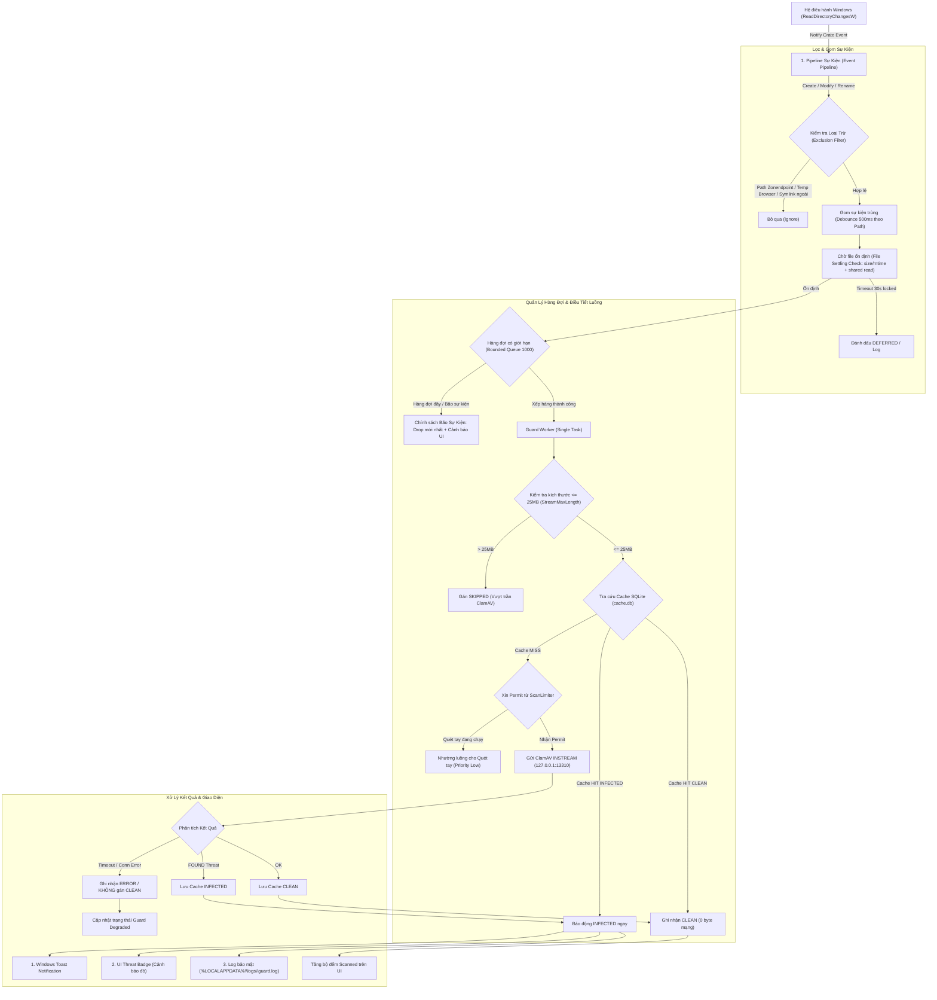

# Thiết Kế Kỹ Thuật: Guard (Bảo Vệ Thời Gian Thực) — Zonendpoint

| Thuộc tính | Chi tiết |
| :--- | :--- |
| **Mã tài liệu** | `docs/design/guard.md` |
| **Nhiệm vụ** | Task V-45 (Vic — Thiết kế Guard, Chỉ viết tài liệu, Không sửa code) |
| **Người thực hiện** | Vic (Backend Engineer) |
| **Người phê duyệt** | Zon (Project Lead) |
| **Ngày hoàn thành** | 2026-11-12 |
| **Nhánh git** | `vic/guard-design` (tạo từ `origin/main 22eb28f`) |
| **Phạm vi áp dụng** | Windows x64, pilot nội bộ doanh nghiệp (Internal Company Pilot) |
| **Trạng thái tính năng** | **Thiết kế kỹ thuật (Design Specification)** — Mặc định TẮT (`OFF`) trong v1.0.0 |

---

## Tóm Tắt Hiện Trạng & Mục Tiêu Thiết Kế

### 1. Hiện trạng mã nguồn (`src-tauri/src/watcher.rs` & `lib.rs`)
Theo đánh giá kỹ thuật từ Loki và rà soát tại commit `22eb28f`:
1. **Phạm vi thô sơ**: Watcher chỉ lắng nghe 3 thư mục `Downloads`, `Desktop`, `Temp` ở chế độ `RecursiveMode::NonRecursive`. File con trong các thư mục con của `Downloads` hoàn toàn bị bỏ lọt.
2. **Sự kiện thiếu sót**: Chỉ bắt `EventKind::Create(_)`. Bỏ qua hoàn toàn `EventKind::Modify(_)` và `EventKind::Rename(_)`. Khi trình duyệt tải file (Chrome/Edge tạo file `.crdownload`, Firefox tạo `.part`), khi hoàn tất tải về sẽ phát sinh sự kiện **Rename** thành file thực tế (`.exe`, `.zip`) — hiện trạng hoàn toàn không quét file sau khi tải xong.
3. **Ổn định file bằng sleep cố định**: Đang dùng `tokio::time::sleep(Duration::from_millis(300))`. Đối với file dung lượng lớn đang ghi, sau 300 ms file vẫn đang mở ghi độc quyền hoặc chỉ mới ghi được vài KB, dẫn đến lỗi mở file (`Sharing Violation`) hoặc quét file chưa hoàn chỉnh.
4. **Nguy cơ cạn kiệt tài nguyên (Thread/Runtime DoS)**: Với mỗi sự kiện phát sinh, watcher thực hiện `thread::spawn` rồi khởi tạo riêng một `tokio::runtime::Builder::new_current_thread()`. Khi xảy ra bão sự kiện (ví dụ giải nén file ZIP chứa hàng nghìn file), hệ thống sẽ spawn hàng nghìn OS thread và runtime Tokio đồng thời, gây cạn kiệt bộ nhớ và sập ứng dụng.
5. **Nuốt kết quả phát hiện**: Kết quả quét bị vứt bỏ hoàn toàn bằng câu lệnh `let _ = crate::scanner::scan_file(...)`. Khi phát hiện mã độc, không có bất kỳ thông báo Toast, cảnh báo UI hay log bảo mật nào được ghi nhận.
6. **Thiếu điều khiển UI**: Chưa có nút bật/tắt Guard trên giao diện (`App.tsx`), chưa có hiển thị số liệu thống kê hay trạng thái hoạt động.

### 2. Mục tiêu thiết kế Guard v1
Xây dựng một kiến trúc bảo vệ thời gian thực **bền bỉ, an toàn, tiết kiệm tài nguyên và không xâm phạm**, tuân thủ nghiêm ngặt các ranh giới bảo mật của Zonendpoint:
- **Nguyên tắc cốt lõi**: Quan sát và cảnh báo sớm (**Observe & Alert Only**), tuyệt đối không tự ý cách ly hay xóa file của người dùng trong phiên bản này.
- **Tiêu chuẩn an toàn**: Không bao giờ nâng trạng thái `ERROR` hoặc `OFFLINE` thành `CLEAN`.
- **Chung sống hòa bình**: Không can thiệp hoặc thêm exclusion vào Windows Defender / Sophos.
- **Bảo mật dữ liệu**: Chỉ truyền luồng INSTREAM tới daemon ClamAV nội bộ qua tunnel bảo mật hiện có (`127.0.0.1:13310`), không truyền bất kỳ dữ liệu nào ra ngoài internet.

---

## Kiến Trúc Tổng Thể Guard

Sơ đồ luồng xử lý sự kiện file từ hệ điều hành tới thông báo người dùng:



---

## 1. Phạm Vi Theo Dõi (Monitoring Scope & Exclusions)

### Quyết định (Decision)
1. **Danh sách thư mục giám sát**:
   - `USERPROFILE\Downloads`: Theo dõi đệ quy (**`RecursiveMode::Recursive`**).
   - `USERPROFILE\Desktop`: Theo dõi không đệ quy (**`RecursiveMode::NonRecursive`**).
   - `TEMP` (`std::env::temp_dir()`, thường là `%USERPROFILE%\AppData\Local\Temp`): Theo dõi không đệ quy (**`RecursiveMode::NonRecursive`**).
   - *Các thư mục khác (Documents, Music, Pictures, C:\...)*: **Không** theo dõi tự động trong phiên bản v1.
2. **Quy tắc đệ quy (Recursive Policy)**:
   - Thư mục `Downloads` cần đệ quy vì các trình duyệt hiện đại hoặc công cụ tải file (Chrome, Telegram Desktop, Slack, IDM) thường tạo thư mục con để chứa file tải.
   - Thư mục `Desktop` và `Temp` chỉ theo dõi tầng gốc (NonRecursive) để tránh bùng nổ theo dõi khi người dùng để các thư mục mã nguồn lớn (`node_modules`, `target`, `.git`) hoặc khi các phần mềm bên thứ ba tạo hàng chục nghìn file tạm lồng nhau trong `Temp`.
3. **Danh sách loại trừ bắt buộc (Exclusions)**:
   - **Thư mục ứng dụng Zonendpoint**: `%LOCALAPPDATA%\Zonendpoint` (bao gồm `cache.db`, `cache.db-wal`, `config.json`, thư mục `logs/*`). Tuyệt đối không giám sát để triệt tiêu nguy cơ vòng lặp tự kích hoạt (Zonendpoint quét -> ghi log/cache -> Watcher kích hoạt -> quét tiếp).
   - **File tải dở của trình duyệt & công cụ download**: `.crdownload` (Chrome/Edge), `.part` (Firefox), `.tmp`, `*.~tmp`, `.download` (Safari/khác), `.opdownload` (Opera), `.lock`, `.swp`, `.aria2`.
   - **File đặc thù của hệ điều hành Windows**: `desktop.ini`, `thumbs.db`, `$RECYCLE.BIN`, `System Volume Information`.
4. **Reparse Points & Symlinks**:
   - Khi phát hiện Reparse Point (Directory Junction, Symbolic Link), Guard thực hiện chuẩn hóa đường dẫn (`dunce::canonicalize` hoặc Win32 `GetFinalPathNameByHandleW`).
   - Nếu đường dẫn đích nằm **ngoài** thư mục gốc đang theo dõi, Guard **bỏ qua ngay lập tức** (không đệ quy theo). Điều này ngăn chặn kẻ tấn công tạo symlink từ `Downloads` trỏ tới `C:\Windows` hoặc vòng lặp symlink đệ quy vô tận.
5. **Ổ mạng & Thiết bị lưu trữ rời (Network Shares & USB)**:
   - Đường dẫn mạng UNC (`\\server\share`), ổ đĩa mạng ánh xạ (`Z:\`), ổ USB Flash / thẻ nhớ di động: **Ngoại phạm vi phiên bản v1 (Out of Scope)**.
   - Người dùng có nhu cầu quét các vị trí này sẽ sử dụng tính năng **Folder Scan** thủ công.

### Lý do (Rationale)
- Hầu hết mã độc xâm nhập máy trạm thông qua kênh tải về từ internet (`Downloads`), file đính kèm lưu tạm trên màn hình làm việc (`Desktop`), hoặc payload drop vào thư mục tạm (`Temp`).
- Giám sát có chọn lọc giúp giữ mức sử dụng CPU của tiến trình dưới 2% khi nghỉ và tránh gây ảnh hưởng tới trải nghiệm làm việc của nhân viên trong đợt thử nghiệm pilot.
- API `ReadDirectoryChangesW` của Windows khi chạy trên ổ mạng SMB thường xuyên mất gói tin sự kiện (dropped events), trễ I/O mạng và tiềm ẩn nguy cơ treo thread. Thiết bị USB có thể bị rút đột ngột gây crash I/O.

### Cách test (Testing Methodology)
- **Test 1.1 (Downloads Recursive)**: Tạo thư mục con `Downloads\Telegram\SubDir\test_payload.txt`. Kiểm tra Watcher bắt được sự kiện tạo file trong thư mục lồng nhau.
- **Test 1.2 (Desktop NonRecursive)**: Tạo thư mục `Desktop\Project\subdir\file.txt`. Kiểm tra Watcher **không** kích hoạt quét với file con trong thư mục con của Desktop.
- **Test 1.3 (Self-Exclusion Loop Prevention)**: Ghi dữ liệu liên tục vào `%LOCALAPPDATA%\Zonendpoint\cache.db` và `guard.log`. Kiểm tra Watcher không phát sinh bất kỳ sự kiện nào (bộ lọc loại trừ hoạt động 100%).
- **Test 1.4 (Symlink Directory Traversal Prevention)**: Dùng lệnh `mklink /D Downloads\sys_link C:\Windows\System32`. Thêm file giả lập vào `C:\Windows\System32`. Kiểm tra Guard không duyệt vào qua symlink.
- **Test 1.5 (In-progress Browser Download Exclusion)**: Tạo file `Downloads\installer.exe.crdownload`. Kiểm tra Guard bỏ qua, không đưa vào hàng đợi quét.

---

## 2. Sự Kiện & Cơ Chế Ổn Định File (Events & File Stabilization)

### Quyết định (Decision)
1. **Phân loại sự kiện lắng nghe (Event Filter)**:
   - `EventKind::Create(_)`: File mới được tạo trên đĩa.
   - `EventKind::Modify(_)`: Dữ liệu file được ghi thêm hoặc metadata được cập nhật.
   - `EventKind::Modify(ModifyKind::Name(RenameMode::To))` hoặc `EventKind::Rename(to)`: **Bắt buộc phải có**. Đây là mắt xích quan trọng nhất để bắt được file tải về từ trình duyệt (khi Chrome tải xong sẽ đổi tên từ `abc.crdownload` thành `abc.exe`).
2. **Cơ chế gom sự kiện (Debounce per Path)**:
   - Áp dụng kỹ thuật Sliding Window Debounce theo từng đường dẫn chuẩn hóa (canonical path) với khoảng thời gian **500 ms**.
   - Khi một tiến trình ghi file liên tục theo từng block dữ liệu (phát sinh hàng trăm sự kiện Modify/Write trong vài giây), mỗi sự kiện mới sẽ reset timer 500 ms của file đó.
   - Chỉ khi trôi qua 500 ms mà không có thêm sự kiện ghi nào mới trên đường dẫn đó, file mới được chuyển tiếp sang bước Kiểm tra Ổn định (File Settling).
3. **Kiểm tra ổn định file (File Settling Check)**:
   - File chỉ được coi là sẵn sàng để quét khi thỏa mãn đồng thời 2 điều kiện:
     1. **Kích thước và thời gian sửa đổi không đổi**: `metadata.len()` và `metadata.modified()` giữ nguyên không đổi qua 2 lần kiểm tra cách nhau 500 ms.
     2. **Mở được file với quyền chia sẻ đọc**: Mở thành công bằng Win32 `CreateFileW` hoặc Rust `File::options().read(true).open(&path)` với cờ chia sẻ đầy đủ (`FILE_SHARE_READ | FILE_SHARE_WRITE | FILE_SHARE_DELETE`).
4. **Thời gian chờ tối đa & Cơ chế thử lại (Settling Timeout & Backoff)**:
   - **Thời gian chờ tối đa (Max Settling Timeout)**: **30 giây**.
   - **Tần suất kiểm tra (Exponential Backoff)**: Thử lại sau các khoảng thời gian tăng dần: 500 ms, 1 s, 2 s, 4 s, 8 s... tối đa 30 s.
   - **Xử lý file bị khóa độc quyền (Exclusive Lock)**: Nếu quá 30 giây mà file vẫn bị khóa bởi ứng dụng khác (ví dụ phần mềm render video đang xuất file dở, hoặc file ISO tải chưa xong):
     - Guard giải phóng file khỏi luồng xử lý hiện tại, ghi log với trạng thái `DEFERRED / LOCKED_TIMEOUT`.
     - Tuyệt đối không làm nghẽn hoặc dừng luồng xử lý của các file khác trong hàng đợi.
     - Khi ứng dụng ghi xong và đóng handle, hệ điều hành sẽ phát sinh sự kiện Close/Modify cuối cùng, kích hoạt chu trình debounce mới.

### Lý do (Rationale)
- Đoạn mã hiện tại chỉ `sleep 300ms` rồi scan là một lỗi thiết kế nghiêm trọng: File 50 MB tải từ mạng mất 5 giây, sau 300 ms chỉ mới tải được vài KB. Nếu quét ngay sẽ gây lỗi `Sharing Violation` hoặc tệ hơn là ClamAV chỉ quét phần đầu file và trả về verdict `CLEAN` sai lầm, sau đó file hoàn tất tải về mà không bao giờ được quét lại!
- Kết hợp Debounce 500 ms + File Settling đảm bảo Guard chỉ quét khi file đã được ghi trọn vẹn xuống đĩa.

### Cách test (Testing Methodology)
- **Test 2.1 (Simulated Progressive Download)**: Viết script mở file `Downloads\payload.bin`, ghi 1 MB dữ liệu mỗi 300 ms trong vòng 3 giây rồi đóng file. Kiểm tra Guard không quét ở giây thứ 1, mà đợi tới giây thứ 3.5 (sau khi file đóng) mới bắt đầu quét đúng 1 lần với đầy đủ 10 MB.
- **Test 2.2 (Browser Rename Workflow)**:
  1. Tạo file `Downloads\setup.exe.crdownload` và ghi dữ liệu.
  2. Đổi tên thành `Downloads\setup.exe`.
  3. Kiểm tra Guard kích hoạt quét ngay khi sự kiện rename kết thúc.
- **Test 2.3 (Exclusive Lock Expiry)**: Mở file `Downloads\locked.dat` với cờ độc quyền (`dwShareMode = 0`) và giữ trong 35 giây. Kiểm tra Guard sau 30 giây ghi nhận trạng thái `DEFERRED / LOCKED_TIMEOUT`, không gây nghẽn hàng đợi, giải phóng thread bình thường.

---

## 3. Quản Lý Tải, Hàng Đợi & Bão Sự Kiện (Load Management & ScanLimiter)

### Quyết định (Decision)
1. **Hàng đợi có giới hạn (Bounded Queue Architecture)**:
   - Thay thế hoàn toàn cơ chế `thread::spawn` vô hạn hiện tại bằng một hàng đợi bất đồng bộ có giới hạn sử dụng `tokio::sync::mpsc::channel(1000)` với sức chứa tối đa **1.000 file**.
   - Guard chỉ sử dụng **1 Worker Task duy nhất** (Background Consumer Task) để điều phối các tác vụ trong hàng đợi.
2. **Dùng chung ScanLimiter với Quét Tay (Manual Scan vs Guard)**:
   - Guard dùng chung instance `Arc<ScanLimiter>` với Quét Tay (Quick Scan và File/Folder Scan) để đảm bảo tổng số kết nối TCP tới ClamAV không vượt quá trần hệ thống (hiện tại là 4 luồng, và sẽ là 6 luồng sau khi nhánh `jacky/concurrency-v2` hoàn thành).
   - **Quy tắc phân bổ & Ưu tiên (Priority Policy)**:
     - **Quét tay (High Priority)**: Người dùng đang chủ động thao tác và nhìn màn hình chờ kết quả.
     - **Guard (Low/Normal Priority)**: Tác vụ bảo vệ ngầm chạy nền.
     - Khi phát hiện Quét tay bắt đầu (`ScanManager.active.is_some()`): Guard lập tức **nhường luồng**: Guard không lấy thêm permit mới từ `ScanLimiter` cho tới khi Quét tay hoàn tất. Nếu Guard đang giữ permit, Guard hoàn thành nốt file hiện tại rồi tạm dừng.
     - Khi hệ thống rảnh (không có quét tay): Guard được phép sử dụng tối đa **$\min(2, \text{ScanLimiter::limit()})$** permit để luôn chừa lại tài nguyên I/O cho hệ điều hành.
3. **Ứng phó Bão Sự Kiện (Event Storm, ví dụ giải nén 10.000 file)**:
   - Khi tốc độ phát sinh sự kiện vượt quá tốc độ quét của ClamAV và hàng đợi chạm ngưỡng 1.000 file (Queue Full):
     - **Chính sách Drop an toàn**: Các sự kiện mới phát sinh sẽ bị loại bỏ khỏi hàng đợi thời gian thực (Drop Newest).
     - **Không mất kết quả INFECTED**: Tất cả các kết quả quét đã hoàn thành hoặc đang xử lý đều được lưu trữ an toàn trong DB và log.
     - **Báo cáo suy giảm chất lượng (Degradation Notification)**: Tăng biến đếm `storm_dropped_count`, kích hoạt cảnh báo trên giao diện người dùng:
       > *"High disk activity detected: Some background events were dropped. Please run a Folder Scan on your directory for full verification."*
4. **Giới hạn kích thước file (`StreamMaxLength` 25 MB)**:
   - Daemon ClamAV trên lab cấu hình trần kích thước luồng `StreamMaxLength 25M` (`MAX_FILE_BYTES = 25 * 1024 * 1024` trong `src-tauri/src/scanner.rs`).
   - Trước khi đưa vào luồng stream mạng, Guard kiểm tra `metadata.len()`:
     - Nếu kích thước file **> 25 MB**: Bỏ qua stream tới clamd, ghi nhận trạng thái **`SKIPPED`** với lý do rõ ràng: `"File size exceeds 25 MB limit (StreamMaxLength)"`.
     - Việc này ngăn ngừa triệt để lỗi ClamAV reset kết nối mạng giữa chừng, bảo vệ tunnel không bị quá tải.

### Lý do (Rationale)
- Mô hình hiện tại (`thread::spawn` trên mỗi event) là quả bom nổ chậm: Một thao tác `git clone` hoặc giải nén file ZIP trong Downloads có thể sinh ra 10.000 thread, làm đơ toàn bộ máy tính của người dùng.
- Bounded queue 1.000 phần tử chiếm chưa đến 2 MB RAM, đảm bảo ứng dụng luôn kiểm soát được tài nguyên.
- Ưu tiên tuyệt đối cho Quét tay giúp giữ phản hồi của ứng dụng luôn mượt mà khi người dùng tương tác trực tiếp.

### Cách test (Testing Methodology)
- **Test 3.1 (Event Storm Resilience)**: Dùng script PowerShell tạo nhanh 3.000 file text rỗng trong thư mục `Downloads` trong vòng 1 giây. Kiểm tra:
  - Ứng dụng Zonendpoint không crash, bộ nhớ RAM tăng không quá 10 MB.
  - Hàng đợi giới hạn đúng 1.000 phần tử, các phần tử vượt ngưỡng được ghi nhận vào `storm_dropped_count`.
  - Giao diện người dùng hiển thị thông báo cảnh báo bão sự kiện chính xác.
- **Test 3.2 (Scan Priority Contention)**: Đưa 100 file vào hàng đợi Guard. Khi Guard đang quét tới file thứ 5, người dùng bấm "Quick Scan". Kiểm tra:
  - Quick Scan lập tức nhận được permit, bắt đầu quét ngay trong vòng < 200 ms.
  - Guard tự động nhường permit, tạm dừng xử lý các file tiếp theo cho tới khi Quick Scan kết thúc hoàn toàn.
- **Test 3.3 (Large File Skipped Check)**: Tạo một file giả lập dung lượng 30 MB (`fsutil file createnew Downloads\large.iso 31457280`). Kiểm tra:
  - Guard không gửi dữ liệu qua socket mạng tới `127.0.0.1:13310`.
  - Kết quả trả về ngay lập tức là `SKIPPED`, lý do ghi rõ `"File size exceeds 25 MB limit"`.

---

## 4. Xử Lý Kết Quả Quét (Verdicts & Actions)

### Quyết định (Decision)
1. **Xử lý khi phát hiện mối đe dọa (INFECTED)**:
   - Khi một file có kết quả `INFECTED`, Guard kích hoạt đồng thời 3 kênh cảnh báo:
     1. **Thông báo Windows (Windows Toast Notification)**:
        - Sử dụng Windows Notification API (thông qua `tauri-plugin-notification` hoặc WinRT API):
        - Tiêu đề: `Zonendpoint Guard - Threat Detected`
        - Nội dung: `[Threat_Name] detected in [File_Name]`
        - Mức độ ưu tiên cao, hiển thị trên góc phải màn hình desktop.
     2. **Mục cảnh báo trong giao diện (In-App Threat Alert)**:
        - Hiển thị badge đỏ trên giao diện ứng dụng với số lượng mối đe dọa phát hiện.
        - Liệt kê chi tiết đường dẫn file và tên signature độc hại trong danh sách cảnh báo của Guard.
     3. **Ghi log bảo mật có cấu trúc (Security Audit Log)**:
        - Ghi một dòng JSON vào file `%LOCALAPPDATA%\Zonendpoint\logs\guard.log`:
          `{"timestamp": 1731412800, "event": "THREAT_DETECTED", "path": "C:\\Users\\...\\Downloads\\bad.exe", "sha256": "...", "threat": "Win.Trojan.Generic", "size": 102400}`
2. **NGUYÊN TẮC CỐT LÕI: TUYỆT ĐỐI KHÔNG CÁCH LY / XÓA / DI CHUYỂN FILE Ở BẢN NÀY (Observe & Alert Only)**:
   - Guard trong phiên bản v1 chỉ thực hiện **phát hiện và cảnh báo**.
   - Không tự động di chuyển file vào vùng cách ly (`Quarantine`), không xóa file, không đổi tên file (`.quarantine`).
   - Tính năng cách ly và phục hồi an toàn thuộc về đề xuất riêng **V/Q-RESPONSE** (giai đoạn P4 trong roadmap) và cần môi trường sandbox có kiểm soát.
3. **Quy tắc bất biến về trạng thái (Safety Invariant)**:
   - Nếu quá trình quét file gặp bất kỳ lỗi nào (socket timeout, server unreachable, IO error, share violation):
   - Kết quả **bắt buộc** phải là `ERROR` hoặc `UNKNOWN`.
   - **TUYỆT ĐỐI KHÔNG BAO GIỜ TỰ ĐỘNG CHUYỂN `ERROR` HOẶC `OFFLINE` THÀNH `CLEAN`!**
4. **Tích hợp Cache SQLite (`cache.db`)**:
   - Sử dụng chung cơ sở dữ liệu `cache.db` và bảng `scan_cache` hiện có (`sha256`, `engine_version`, `policy_version`, `status`, `threat_name`).
   - Khi một file đã ổn định, Guard tính hash SHA-256 nhanh của file:
     - Nếu **Cache HIT CLEAN** (trùng hash, cùng engine version và số lượng chữ ký): Ghi nhận `CLEAN` ngay lập tức mà không cần gửi dữ liệu qua mạng -> **Tiết kiệm 95% I/O mạng lab**.
     - Nếu **Cache HIT INFECTED**: Báo động lập tức không cần chờ quét lại.
     - Nếu **Cache MISS**: Gửi dữ liệu tới clamd qua INSTREAM. Nếu clamd trả về kết quả hợp lệ, ghi kết quả mới vào `cache.db`.

### Lý do (Rationale)
- Tránh nguy cơ mất dữ liệu của người dùng do nhận diện nhầm (False Positive). Một công cụ nội bộ không được phép xóa nhầm file tài liệu hoặc source code của kỹ sư khi chưa có cơ chế hoàn tác đã qua kiểm chứng (Recovery Guarantee).
- Tái sử dụng Cache SQLite giúp tốc độ quét thời gian thực đạt mức mili-giây đối với các file đã được quét trong các lần Quick Scan trước đó.

### Cách test (Testing Methodology)
- **Test 4.1 (Toast & Alert on Infection)**: Thả file chứa chữ ký test vào `Downloads`. Kiểm tra:
  - Windows Toast xuất hiện đúng tên signature và đường dẫn.
  - Ứng dụng Zonendpoint hiển thị badge cảnh báo màu đỏ.
  - File gốc trên ổ đĩa vẫn nguyên vẹn (không bị xóa hay đổi thuộc tính).
- **Test 4.2 (No Upgrade of Error to Clean)**: Ngắt kết nối mạng tới clamd, thả file mới vào `Downloads`. Kiểm tra:
  - Guard ghi nhận kết quả `ERROR (Connection refused)`.
  - Kết quả không bao giờ chuyển thành `CLEAN`, không ghi `CLEAN` vào `cache.db`.
- **Test 4.3 (Cache Hit Performance)**: Quét một file 10 MB bằng Folder Scan để nạp vào cache. Sau đó copy file đó sang `Downloads`. Kiểm tra:
  - Guard xử lý file trong vòng < 10 ms (Cache Hit).
  - Không có gói tin TCP nào gửi tới `127.0.0.1:13310`.

---

## 5. Xử Lý Khi Server Offline / Tunnel Rớt (Resilience & Offline Handling)

### Quyết định (Decision)
1. **Phát hiện mất kết nối (Offline Detection)**:
   - Khi Guard kết nối tới `127.0.0.1:13310` mà gặp lỗi `ConnectionRefused`, `TimedOut` (sau 5s), hoặc preflight `zVERSION` thất bại:
   - Guard xác định trạng thái kết nối chuyển thành **OFFLINE**.
2. **Chính sách xử lý hàng đợi khi Server Offline**:
   - Khi phát hiện server offline:
     - **Tạm dừng xử lý (Pause Dequeuing)**: Ngừng lấy các file mới từ hàng đợi để tránh lặp đi lặp lại các lỗi kết nối vô nghĩa.
     - **Bộ đệm chờ ngắn hạn (Grace Buffer)**: Duy trì tối đa 100 sự kiện file gần nhất trong bộ nhớ trong khoảng thời gian chờ tối đa **60 giây**.
     - **Xả hàng đợi khi ngắt kết nối kéo dài**: Nếu sau 60 giây mà tunnel vẫn không phục hồi (ví dụ máy tính mang ra ngoài không có VPN/tunnel về lab):
       - Guard xả sạch (flush) các file đang chờ, ghi log: `[GUARD_OFFLINE] Flushed N pending items due to extended server disconnection`.
       - Chuyển trạng thái Guard sang: **`Paused (Server Offline)`**.
3. **Hiển thị trạng thái trên UI**:
   - Khi server offline, chấm trạng thái kết nối cạnh logo chuyển sang màu **ĐỎ** (theo chuẩn `v1.0.0-scope.md`).
   - Nút bật/tắt Guard hiển thị tooltip cảnh báo: `"Real-Time Guard is paused: ZonEndpoint server is unreachable"`.
4. **Cơ chế tự động hồi phục khi có mạng lại (Auto-Recovery)**:
   - Vòng lặp kiểm tra kết nối định kỳ (chạy mỗi 30 giây trong Tauri backend) hoặc khi người dùng click vào chấm đỏ để kết nối lại:
   - Khi kết nối socket thành công và banner `zVERSION` hợp lệ:
     - Chấm trạng thái chuyển sang màu **XANH**.
     - Guard tự động chuyển trạng thái từ `Paused` sang **`Active`** và bắt đầu đón nhận các sự kiện file mới.
     - **Không quét lùi (No Historical Rescan)**: Guard **không** tự động quét lại toàn bộ cây thư mục để tránh gây đơ máy do dồn tải. Thay vào đó, UI hiển thị gợi ý thân thiện:
       > *"Connection restored. Guard is active. Click to run a Quick Scan to inspect recent changes."*

### Lý do (Rationale)
- Tránh tình trạng rò rỉ bộ nhớ (Memory Leak) do tích tụ hàng nghìn file trong RAM khi người dùng ngắt kết nối trong thời gian dài (ví dụ tắt máy, đi công tác).
- Tránh việc máy vừa có mạng trở lại thì Guard lập tức quét ồ ạt làm treo hệ thống.

### Cách test (Testing Methodology)
- **Test 5.1 (Tunnel Disconnect During Guard Operation)**:
  1. Bật Guard hoạt động bình thường.
  2. Tắt process SSH tunnel (kill port 13310).
  3. Thả 5 file vào `Downloads`.
  4. Kiểm tra: Guard không bị panic/crash, log ghi nhận tạm dừng sau 60 giây, bộ nhớ không tăng.
- **Test 5.2 (Auto-Recovery When Tunnel Reconnects)**:
  1. Mở lại tunnel SSH tới clamd.
  2. Bấm vào chấm đỏ hoặc đợi 30 giây.
  3. Kiểm tra: Chấm chuyển xanh, Guard tự động chuyển sang `Active`. Thả file mới vào `Downloads` và file được quét ngay.

---

## 6. Thiết Kế Giao Diện Người Dùng (UI / UX)

### Quyết định (Decision)
1. **Bố cục & Vị trí điều khiển**:
   - Thêm một hàng điều khiển Guard tinh gọn ngay phía trên hoặc trong khu vực điều khiển quét của `App.tsx`.
   - Thiết kế đảm bảo tuân thủ kích thước cửa sổ cố định **800×240 px** mà không xuất hiện thanh cuộn ngang hoặc dọc.
2. **Các thành phần giao diện**:
   - **Nút chuyển đổi Bật/Tắt (Toggle Switch)**:
     - Nhãn rõ ràng: `Real-Time Guard: [ ON | OFF ]`.
     - Kích thước vùng bấm tối thiểu **$44\times 44\text{ px}$** đáp ứng tiêu chuẩn Accessibility (WCAG 2.1 AA).
     - Hỗ trợ phím tắt và bàn phím (phím `Space` hoặc `Enter` khi focus vào nút).
   - **Trạng thái mặc định**: **LUÔN TẮT (`OFF`)** khi ứng dụng cài đặt lần đầu hoặc khởi động lại (trừ khi người dùng đã chủ động bật và lưu cấu hình).
   - **Lưu cấu hình bền vững (Persistence)**:
     - Lưu trường `guard_enabled: bool` trong file `%LOCALAPPDATA%\Zonendpoint\config.json`.
     - Khi ứng dụng khởi động, nạp cấu hình từ file. Nếu `guard_enabled == true` và server đang kết nối (chấm xanh), Guard tự động kích hoạt.
   - **Bộ đếm thời gian thực (Live Metrics Display)**:
     - `Scanned`: Tổng số file Guard đã kiểm tra trong phiên làm việc hiện tại.
     - `Pending`: Số file đang nằm trong hàng đợi chờ kiểm tra.
     - `Detected`: Số mối đe dọa phát hiện được (hiển thị badge đỏ nổi bật nếu $> 0$).
3. **Tiêu chuẩn bản địa hóa & Theme**:
   - 100% văn bản giao diện bằng **Tiếng Anh** (theo quy định tại `v1.0.0-scope.md`).
   - Sử dụng đúng hệ thống biến CSS tokens của ứng dụng (`var(--bg)`, `var(--text)`, `var(--accent)`, `var(--border)`), hỗ trợ liền mạch cả **Light Theme** và **Dark Theme**.
4. **Khóa an toàn khi mất mạng**:
   - Nếu Server Status đang là `disconnected` (chấm đỏ), nút Guard sẽ ở trạng thái vô hiệu hóa (disabled) hoặc bật lên sẽ kèm tooltip giải thích: *"Server offline. Connect to ZonEndpoint server before enabling Guard."*

### Lý do (Rationale)
- Tôn trọng quyền kiểm soát của người dùng: Bảo vệ thời gian thực là tính năng tốn tài nguyên I/O, do đó phải là lựa chọn chủ động của người dùng (Opt-in), không được ép buộc bật ngầm.
- Phù hợp với ngôn ngữ thiết kế tối giản, gọn gàng hiện có của ứng dụng Zonendpoint.

### Cách test (Testing Methodology)
- **Test 6.1 (Default State & Persistence)**:
  1. Cài đặt app hoặc xóa `config.json`. Mở app -> Guard hiển thị `OFF`.
  2. Bấm bật Guard -> Nút chuyển `ON`.
  3. Đóng hoàn toàn app, mở lại -> Nút vẫn giữ trạng thái `ON`.
- **Test 6.2 (Live Counters Accuracy)**:
  1. Bật Guard. Thả 3 file sạch vào `Downloads`.
  2. Kiểm tra bộ đếm: `Scanned: 3`, `Pending: 0`, `Detected: 0`.
  3. Thả 1 file test độc hại.
  4. Kiểm tra bộ đếm: `Scanned: 4`, `Detected: 1` (badge đổi sang màu đỏ).
- **Test 6.3 (Theme Compatibility)**:
  1. Bật theme Dark, sau đó chuyển sang Light.
  2. Kiểm tra độ tương phản văn bản, viền nút, trạng thái hover đạt chuẩn, không vỡ layout 800×240.

---

## 7. Chung Sống Hòa Bình Với Antivirus Cài Sẵn (Defender / Sophos Coexistence)

### Quyết định (Decision)
1. **Chính sách không xâm lấn (Non-Intrusive Policy)**:
   - **Tuyệt đối KHÔNG** thêm thư mục hay tiến trình Zonendpoint vào danh sách loại trừ (Exclusion List) của Windows Defender hoặc Sophos (không gọi lệnh PowerShell `Add-MpPreference`, không sửa registry Defender).
   - **Tuyệt đối KHÔNG** cố gắng tắt, dừng dịch vụ, hoặc can thiệp vào tiến trình của các giải pháp diệt virus / EDR chính trên máy.
2. **Xử lý khi Antivirus chính chặn đọc file**:
   - Khi một file độc hại xuất hiện, Windows Defender hoặc Sophos (chạy ở mức Kernel Mini-filter Driver) thường phát hiện và khóa file trước khi Zonendpoint kịp đọc.
   - Khi Zonendpoint cố gắng mở file để stream dữ liệu, hệ điều hành Windows sẽ trả về lỗi:
     - Mã lỗi Win32 `ERROR_VIRUS_INFECTED` (Mã lỗi `225` / `0x000000E1`): *"Operation did not complete successfully because the file contains a virus or potentially unwanted software"*.
     - Hoặc mã lỗi Win32 `ERROR_ACCESS_DENIED` (Mã lỗi `5`) / `ERROR_SHARING_VIOLATION` (Mã lỗi `32`).
   - **Hành vi xử lý của Guard**:
     - Bắt chính xác mã lỗi hệ điều hành trả về: Nếu mã lỗi là `225` hoặc mã lỗi `5` do AV khóa:
     - Ghi nhận trạng thái: **`SKIPPED / BLOCKED_BY_AV`** hoặc `ERROR` với lý do rõ ràng:
       `"File access blocked by host antivirus (Defender/Sophos)"`.
     - Tuyệt đối **không** thử lại (no retry), không báo lỗi crash ứng dụng.
     - Không cố gắng giành quyền truy cập với Antivirus chính.

### Lý do (Rationale)
- Zonendpoint trong mô hình doanh nghiệp đóng vai trò là giải pháp rà soát chuyên sâu bổ trợ (Second-Opinion / Threat Intelligence Gateway), không phải trình điều khiển mức nhân (Kernel Driver) thay thế EDR của công ty.
- Việc cố gắng tranh chấp file với Defender/Sophos sẽ gây ra tình trạng khóa chết (Deadlock) hệ thống tập tin hoặc khiến Zonendpoint bị hệ thống EDR đánh dấu là hành vi đáng ngờ.

### Cách test (Testing Methodology)
- **Test 7.1 (Win32 Error 225 Handling)**: Tạo một test case giả lập hàm đọc file trả về mã lỗi Windows `ERROR_VIRUS_INFECTED (225)`. Kiểm tra Guard ghi nhận trạng thái `BLOCKED_BY_AV`, thoát hàm an toàn và log lý do chính xác.
- **Test 7.2 (Zero Exclusion Audit)**: Chạy lệnh `Get-MpPreference | Select-Object -ExpandProperty ExclusionPath` trước và sau khi cài đặt/chạy Guard. Kiểm tra danh sách exclusion của Windows Defender hoàn toàn không bị thêm bất kỳ đường dẫn nào từ Zonendpoint.

---

## 8. Riêng Tư Và An Toàn Dữ Liệu (Privacy & Security Boundaries)

### Quyết định (Decision)
1. **Luồng dữ liệu duy nhất (Strict Network Boundary)**:
   - Toàn bộ nội dung file chỉ được phép truyền trực tiếp qua luồng ClamAV `INSTREAM` tới địa chỉ socket nội bộ đã cấu hình (`127.0.0.1:13310` qua SSH/Tailscale tunnel đã được phê duyệt).
   - **Tuyệt đối KHÔNG** gửi bất kỳ dữ liệu nào ra máy chủ bên ngoài internet (Không tích hợp VirusTotal, không gửi telemetry, không gọi API đám mây công cộng).
2. **Chính sách ghi Log an toàn (No Payload Logging)**:
   - File log `%LOCALAPPDATA%\Zonendpoint\logs\guard.log` chỉ được phép ghi các thông tin siêu dữ liệu (metadata):
     - Thời gian (Timestamp UTC/Local).
     - Đường dẫn file chuẩn hóa (Canonical Path).
     - Kích thước file (File size bytes).
     - Mã băm SHA-256 (File SHA-256 hash).
     - Kết quả quét (Scan Verdict) và tên chữ ký độc hại nếu có.
     - Thời gian quét (Duration milliseconds).
   - **Tuyệt đối KHÔNG** ghi nội dung nhị phân (binary content), chuỗi văn bản trong file, hoặc dữ liệu nhạy cảm của người dùng vào log hay console terminal.
3. **Nguyên tắc đặc quyền tối thiểu (Least Privilege)**:
   - Tiến trình Guard chạy hoàn toàn dưới quyền người dùng thông thường (Standard User Token) đang đăng nhập.
   - Không yêu cầu quyền Administrator, không tự động nâng quyền (No UAC elevation).

### Lý do (Rationale)
- Bảo vệ tuyệt đối bí mật kinh doanh, mã nguồn và tài liệu nội bộ của công ty trong đợt thử nghiệm pilot.
- Đảm bảo tuân thủ các quy định bảo vệ dữ liệu doanh nghiệp và chính sách an ninh mạng do Zon đề ra.

### Cách test (Testing Methodology)
- **Test 8.1 (Network Traffic Inspection)**: Sử dụng Wireshark / Netstat giám sát toàn bộ lưu lượng mạng khi Guard đang hoạt động:
  - Xác nhận 100% gói tin mạng chỉ di chuyển giữa `127.0.0.1` tới port `13310`.
  - Không có bất kỳ gói tin DNS query hay HTTPS request nào ra ngoài internet.
- **Test 8.2 (Data Leak Audit in Logs)**: Tạo một file văn bản chứa chuỗi bí mật `CONFIDENTIAL_SECRET_TOKEN_XYZ`. Để Guard quét file này. Mở file log `guard.log` và kiểm tra toàn bộ chuỗi: xác nhận chuỗi bí mật hoàn toàn không xuất hiện trong file log.

---

## 9. Kế Hoạch Triển Khai, Kế Hoạch QA & Câu Hỏi Phê Duyệt

### 1. Kế hoạch triển khai chia nhỏ (Phased Tasks V-46 đến V-49)

Việc triển khai Guard sẽ được tách thành 4 task kỹ thuật độc lập, mỗi task đều có test tự động và bàn giao độc lập:

| Task | Tên Nhiệm Vụ | Nội Dung Thực Hiện | Tiêu Chuẩn Nghiệm Thu & Test |
| :--- | :--- | :--- | :--- |
| **V-46** | **Pipeline Sự Kiện & Ổn Định File** (`watcher.rs`) | - Cấu hình `notify` hỗ trợ đệ quy cho `Downloads` và non-recursive cho `Desktop`, `Temp`.<br>- Bắt sự kiện `Create`, `Modify`, `Rename(to)`.<br>- Triển khai Sliding Debounce 500ms.<br>- Kiểm tra Settling (size + mtime + shared read) với timeout 30s. | - 100% unit tests của `watcher.rs` pass.<br>- Test giả lập ghi file chậm và browser download rename thành công. |
| **V-47** | **Hàng Đợi Có Giới Hạn & Phân Bổ Luồng** | - Triển khai `tokio::sync::mpsc::channel(1000)`.<br>- Tích hợp `ScanLimiter` (phối hợp trần luồng 6 từ J-03).<br>- Cơ chế nhường luồng khi có Quét tay.<br>- Bỏ qua file > 25MB (`SKIPPED`).<br>- Tích hợp tra cứu cache SQLite. | - Test bão sự kiện 2.000 file không làm tràn RAM.<br>- Quét tay ưu tiên chiếm permit trước Guard. |
| **V-48** | **Xử Lý Kết Quả, Toast & Chống Rớt Mạng** | - Gửi Windows Toast Notification khi phát hiện `INFECTED`.<br>- Ghi log có cấu trúc vào `guard.log`.<br>- Cơ chế Grace Buffer 60s và Pause khi server offline.<br>- Tự phục hồi khi server online trở lại. | - Toast hiển thị đúng trên Windows 10/11.<br>- Server ngắt kết nối không gây crash loop, tự hồi phục khi mở lại. |
| **V-49** | **Tích Hợp Giao Diện Người Dùng** (`App.tsx`) | - Thêm nút Bật/Tắt Guard và bộ đếm Scanned / Pending / Detected.<br>- Lưu cấu hình vào `config.json`.<br>- Xử lý trạng thái vô hiệu hóa khi mất mạng.<br>- Hỗ trợ Light & Dark theme. | - Thao tác bật/tắt mượt mà, lưu trạng thái qua các lần mở app.<br>- Giao diện chuẩn không vỡ layout 800×240. |

---

### 2. Kế hoạch QA chi tiết cho Qeen

#### Nguyên tắc an toàn tuyệt đối cho QA:
- **TUYỆT ĐỐI KHÔNG DÙNG EICAR HOẶC MALWARE THẬT.**
  - *Lý do*: File test EICAR sẽ bị Windows Defender hoặc Sophos tiêu diệt ngay lập tức ở tầng OS trước khi Guard kịp xử lý, làm sai lệch toàn bộ kết quả kiểm thử; malware thật vi phạm chính sách bảo mật máy trạm của doanh nghiệp.
- **Giải pháp: SỬ DÙNG CHỮ KÝ GIẢ VÔ HẠI (Harmless Benign Test Signature) TRÊN LAB CLAMD**:
  - Thêm một quy tắc chữ ký tùy chỉnh vào file database cục bộ trên server lab ClamAV (`/var/lib/clamav/local_qa_test.ndb`):
    ```text
    Zonendpoint.Test.BenignSignature:0:*:5a6f6e656e64706f696e742d51412d546573742d536166652d32303236
    ```
    *(Khớp với chuỗi văn bản ASCII an toàn: `Zonendpoint-QA-Test-Safe-2026`)*.
  - File test chỉ là một file văn bản `.txt` thông thường chứa chuỗi ký tự trên.
  - Các giải pháp AV khác (Defender/Sophos) hoàn toàn bỏ qua file này vì không có mã nguy hiểm.
  - ClamAV lab sẽ phát hiện chính xác là: `Zonendpoint.Test.BenignSignature FOUND`.

#### Ma trận Kịch bản Kiểm thử QA (QA Test Matrix):

| Mã Test | Tên Kịch Bản | Thao Tác Thực Hiện | Kết Quả Kỳ Vọng (Pass Criteria) |
| :--- | :--- | :--- | :--- |
| **Q-GUARD-01** | Bật/Tắt & Lưu Cấu Hình | 1. Bật Guard trên UI.<br>2. Kiểm tra `config.json`.<br>3. Tắt ứng dụng, mở lại. | Nút hiển thị đúng trạng thái ON; file config lưu `guard_enabled: true`; mở lại app vẫn giữ ON. |
| **Q-GUARD-02** | Phát Hiện Mã Độc Thời Gian Thực | Thả file chứa chuỗi test vô hại vào `Downloads`. | 1. Windows Toast xuất hiện trong vòng 2 giây.<br>2. Badge cảnh báo trên UI hiển thị 1 Detected.<br>3. File gốc KHÔNG bị xóa hay di chuyển. |
| **Q-GUARD-03** | Quét File Sạch Im Lặng | Thả một file `.txt` bình thường vào `Downloads`. | 1. Không hiện thông báo Toast làm phiền.<br>2. Bộ đếm `Scanned` tăng thêm 1.<br>3. File được lưu vào `cache.db`. |
| **Q-GUARD-04** | Tải File Trình Duyệt (Rename) | Tạo file `test.crdownload`, ghi nội dung test, sau đó đổi tên thành `test.exe`. | Guard bỏ qua khi còn đuôi `.crdownload`, và lập tức quét phát hiện khi đổi tên thành `.exe`. |
| **Q-GUARD-05** | Giới Hạn File 25MB (StreamMaxLength) | Tạo file dung lượng 28 MB trong `Downloads`. | Guard không stream qua mạng, ghi nhận `SKIPPED` với lý do kích thước vượt quá 25 MB. |
| **Q-GUARD-06** | Khả Năng Chịu Bão Sự Kiện | Giải nén một file ZIP chứa 2.000 file nhỏ vào `Downloads`. | RAM tiến trình tăng < 15 MB, CPU < 15%, không crash, cảnh báo hàng đợi đầy xuất hiện rõ ràng. |
| **Q-GUARD-07** | Server Mất Kết Nối & Tự Hồi Phục | 1. Ngắt tunnel SSH.<br>2. Thả file vào Downloads.<br>3. Kết nối lại tunnel sau 1 phút. | Chấm trạng thái đổi đỏ; Guard tạm dừng không crash; khi có mạng lại tự động hoạt động bình thường. |
| **Q-GUARD-08** | Quét Đồng Thời (Guard + Manual) | Bật Guard, thả 20 file vào hàng đợi, đồng thời bấm "Quick Scan". | Quick Scan chạy mượt mà, Guard tự nhường luồng, không xảy ra deadlock hay tranh chấp. |

---

### 3. Rủi ro kỹ thuật & Danh sách câu hỏi cần Zon phê duyệt

#### Các rủi ro kỹ thuật đã nhận diện:
1. **Rủi ro I/O giật lag trên máy cấu hình yếu**: Việc theo dõi đệ quy thư mục `Downloads` có thể gây tốn CPU nếu người dùng tải về các dự án mã nguồn lớn chứa hàng chục nghìn file nhỏ (`node_modules`, `.git`).
2. **Tranh chấp file giữa Guard và trình duyệt**: Một số trình duyệt trên Windows khóa file rất lâu sau khi tải xong để kiểm tra SmartScreen. Nếu hết 30 giây mà file vẫn bị khóa, Guard sẽ đánh dấu `DEFERRED`.

#### Danh sách 5 câu hỏi cần Zon phê duyệt:

> [!IMPORTANT]
> **Câu hỏi 1 (Ưu tiên phân bổ luồng ScanLimiter)**:
> Khi Quét tay (Quick Scan hoặc Folder Scan) đang chạy, Zon có duyệt phương án: **Guard lập tức nhường 100% luồng cho Quét tay** (Guard tạm dừng rút permit cho tới khi Quét tay xong), hay Guard vẫn được giữ lại tối đa 1 permit để quét ngầm song song?
> *(Khuyến nghị của Vic: Nhường 100% luồng để Quét tay đạt tốc độ nhanh nhất cho trải nghiệm người dùng)*.

> [!IMPORTANT]
> **Câu hỏi 2 (Loại trừ thư mục mã nguồn trong Downloads)**:
> Thư mục `Downloads` được theo dõi đệ quy. Nếu kỹ sư clone repo git hoặc tải source code giải nén vào `Downloads`, hàng chục nghìn file trong `.git`, `node_modules`, `target`, `.vscode` sẽ tràn vào hàng đợi. Zon có duyệt **loại trừ mặc định** các thư mục này không?
> *(Khuyến nghị của Vic: Có loại trừ các thư mục dự án này để tránh bão sự kiện giả)*.

> [!IMPORTANT]
> **Câu hỏi 3 (Chính sách khi bão sự kiện tràn hàng đợi 1.000 file)**:
> Khi hàng đợi đầy (1.000 file), Zon có duyệt chính sách: **Bỏ qua các sự kiện mới nhất (Drop Newest), tăng biến đếm cảnh báo và hiển thị thông báo khuyến nghị người dùng chạy Folder Scan thủ công**, thay vì tăng kích thước hàng đợi gây nguy cơ tràn RAM?
> *(Khuyến nghị của Vic: Duyệt Drop Newest để bảo vệ an toàn tuyệt đối cho hệ thống máy trạm)*.

> [!IMPORTANT]
> **Câu hỏi 4 (Thời gian chờ file ổn định - Settling Timeout)**:
> Thời gian chờ tối đa để file mở được quyền đọc chia sẻ được đề xuất là **30 giây** (thử lại theo exponential backoff). Sau 30 giây nếu file vẫn bị khóa độc quyền (ví dụ file ISO/video đang render hàng giờ), Guard sẽ hủy theo dõi đợt này và log `DEFERRED`. Zon có đồng ý với ngưỡng 30 giây này không?
> *(Khuyến nghị của Vic: 30 giây là tối ưu, cân bằng giữa file tải lớn và không giữ tài nguyên hàng đợi)*.

> [!IMPORTANT]
> **Câu hỏi 5 (Trải nghiệm thông báo Windows Toast)**:
> Zon có duyệt phương án: **Windows Toast CHỈ xuất hiện khi phát hiện mối đe dọa (INFECTED)**, và hoàn toàn im lặng (silent) đối với các file sạch hoặc file lỗi nhẹ để không làm phiền người dùng?
> *(Khuyến nghị của Vic: Chỉ thông báo khi có INFECTED, giữ đúng triết lý tối giản, không spam thông báo)*.
