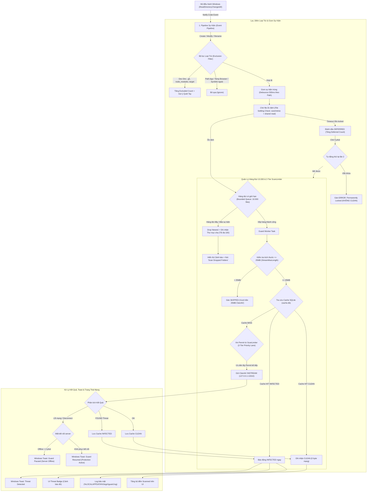

# Thiết Kế Kỹ Thuật: Guard (Bảo Vệ Thời Gian Thực) — Zonendpoint

| Thuộc tính | Chi tiết |
| :--- | :--- |
| **Mã tài liệu** | `docs/design/guard.md` |
| **Nhiệm vụ** | Task V-45 & V-46 (Vic — Thiết kế Guard v1, Cập nhật theo quyết định phê duyệt của Zon ngày 2026-11-12) |
| **Người thực hiện** | Vic (Backend Engineer) |
| **Người phê duyệt** | Zon (Project Lead) — Phê duyệt 5 quyết định kiến trúc theo phương án Loki |
| **Ngày hoàn thành** | 2026-11-12 |
| **Nhánh git** | `vic/guard-design` (tạo từ `origin/main 22eb28f`) |
| **Phạm vi áp dụng** | Windows x64, pilot nội bộ doanh nghiệp (Internal Company Pilot) |
| **Trạng thái tính năng** | **Thiết kế kỹ thuật hoàn chỉnh (Approved Design Specification)** — Mặc định TẮT (`OFF`) trong v1.0.0 |

---

## Tóm Tắt Hiện Trạng & Quyết Định Phê Duyệt Của Zon

### 1. Hiện trạng mã nguồn (`src-tauri/src/watcher.rs` & `lib.rs`)
Theo đánh giá kỹ thuật từ Loki và rà soát tại commit `22eb28f`:
1. **Phạm vi thô sơ**: Watcher chỉ lắng nghe 3 thư mục `Downloads`, `Desktop`, `Temp` ở chế độ `RecursiveMode::NonRecursive`. File con trong các thư mục con của `Downloads` hoàn toàn bị bỏ lọt.
2. **Sự kiện thiếu sót**: Chỉ bắt `EventKind::Create(_)`. Bỏ qua hoàn toàn `EventKind::Modify(_)` và `EventKind::Rename(_)`. Khi trình duyệt tải file (Chrome/Edge tạo file `.crdownload`, Firefox tạo `.part`), khi hoàn tất tải về sẽ phát sinh sự kiện **Rename** thành file thực tế (`.exe`, `.zip`) — hiện trạng hoàn toàn không quét file sau khi tải xong.
3. **Ổn định file bằng sleep cố định**: Đang dùng `tokio::time::sleep(Duration::from_millis(300))`. Đối với file dung lượng lớn đang ghi, sau 300 ms file vẫn đang mở ghi độc quyền hoặc chỉ mới ghi được vài KB, dẫn đến lỗi mở file (`Sharing Violation`) hoặc quét file chưa hoàn chỉnh.
4. **Nguy cơ cạn kiệt tài nguyên (Thread/Runtime DoS)**: Với mỗi sự kiện phát sinh, watcher thực hiện `thread::spawn` rồi khởi tạo riêng một `tokio::runtime::Builder::new_current_thread()`. Khi xảy ra bão sự kiện (ví dụ giải nén file ZIP chứa hàng nghìn file), hệ thống sẽ spawn hàng nghìn OS thread và runtime Tokio đồng thời, gây cạn kiệt bộ nhớ và sập ứng dụng.
5. **Nuốt kết quả phát hiện**: Kết quả quét bị vứt bỏ hoàn toàn bằng câu lệnh `let _ = crate::scanner::scan_file(...)`. Khi phát hiện mã độc, không có bất kỳ thông báo Toast, cảnh báo UI hay log bảo mật nào được ghi nhận.
6. **Thiếu điều khiển UI**: Chưa có nút bật/tắt Guard trên giao diện (`App.tsx`), chưa có hiển thị số liệu thống kê hay trạng thái hoạt động.

### 2. Các quyết định kiến trúc đã được Zon phê duyệt (2026-11-12)
1. **Chia luồng ScanLimiter**: **KHÔNG** nhường 100% luồng cho Quét tay. Guard được thiết lập một làn ưu tiên (Priority Lane) để **lấy ngay permit kế tiếp** của `ScanLimiter` (vượt qua hàng chờ của Quét tay) khi có bất kỳ luồng nào hoàn tất trả permit về, tối đa 1 permit đang dùng mỗi lúc. Không chiếm giữ chỗ cố định khi Guard rảnh.
2. **Loại trừ thư mục dự án**: **Đồng ý loại trừ mặc định** các thư mục `.git`, `node_modules`, `target`, `.vscode` trong `Downloads` để chống bão sự kiện giả. Tuy nhiên, hệ thống phải **đếm và hiển thị số file bị bỏ qua** (`Excluded: N`), có cấu hình `guard_exclude_dev_dirs: bool` để người dùng chủ động tắt loại trừ, đồng thời ghi rõ cảnh báo rủi ro mã độc trong `node_modules` và hướng dẫn người dùng quét thủ công bằng Folder Scan.
3. **Hàng đợi & Xử lý bão sự kiện**: **Nâng sức chứa hàng đợi lên 10.000 file**. Khi tràn hàng đợi: Áp dụng **Drop Newest + cảnh báo**, ĐỒNG THỜI ghi nhận tập hợp các thư mục cha có file bị bỏ qua (giới hạn lưu tối đa **~100 thư mục cha**, nếu vượt quá thì hiển thị `"và N thư mục khác"`). Cung cấp nút bấm tiện ích **`"Scan Dropped Folders"` / `"Quét các thư mục này"`** trên UI. Đảm bảo **không bao giờ mất dấu file nào trong im lặng (Zero Silent Drops)**.
4. **Xử lý file bị khóa (Settling Timeout 30s & Retry)**: Giữ mốc 30s timeout. File bị khóa quá 30s được đánh dấu **`DEFERRED`**, hiển thị số đếm trong app (`Deferred: N`), và hệ thống **tự động thử lại 1 lần sau ~5 phút**. Nếu lần 2 vẫn tiếp tục bị khóa độc quyền $\rightarrow$ Ghi nhận kết quả chính thức là **`ERROR`** có lý do rõ ràng, **tuyệt đối KHÔNG BAO GIỜ thành `CLEAN`**.
5. **Thông báo Windows Toast**: Bắn Toast khi phát hiện **`INFECTED`**. Bổ sung thêm **1 Toast khi Guard ngừng bảo vệ** (mất kết nối server/tunnel liên tục $> 2$ phút), và **1 Toast khi kết nối được khôi phục**. Áp dụng cơ chế cooldown chống spam thông báo khi mạng chập chờn.

---

## Kiến Trúc Tổng Thể Guard

Sơ đồ luồng xử lý sự kiện file từ hệ điều hành tới thông báo người dùng và giao diện:



---

## 1. Phạm Vi Theo Dõi & Danh Sách Loại Trừ (Scope & Exclusions)

### Quyết định (Decision)
1. **Danh sách thư mục giám sát**:
   - `USERPROFILE\Downloads`: Theo dõi đệ quy (**`RecursiveMode::Recursive`**).
   - `USERPROFILE\Desktop`: Theo dõi không đệ quy (**`RecursiveMode::NonRecursive`**).
   - `TEMP` (`std::env::temp_dir()`, thường là `%USERPROFILE%\AppData\Local\Temp`): Theo dõi không đệ quy (**`RecursiveMode::NonRecursive`**).
   - *Các thư mục khác (Documents, Music, Pictures, C:\...)*: **Không** theo dõi tự động trong phiên bản v1.
2. **Quy tắc đệ quy (Recursive Policy)**:
   - Thư mục `Downloads` cần đệ quy vì các trình duyệt hiện đại hoặc công cụ tải file (Chrome, Telegram Desktop, Slack, IDM) thường tạo thư mục con để chứa file tải.
   - Thư mục `Desktop` và `Temp` chỉ theo dõi tầng gốc (NonRecursive) để tránh bùng nổ theo dõi khi người dùng để các thư mục mã nguồn lớn hoặc khi các phần mềm bên thứ ba tạo hàng chục nghìn file tạm lồng nhau trong `Temp`.
3. **Loại trừ mặc định các thư mục mã nguồn/dự án trong `Downloads` (Zon duyệt)**:
   - Mặc định loại trừ các thư mục: `.git`, `node_modules`, `target`, `.vscode`.
   - **Bộ đếm loại trừ**: Hệ thống đếm chính xác số file bị bỏ qua do bộ lọc này (`excluded_count`) và hiển thị lên giao diện UI: `Excluded: N`.
   - **Cấu hình tùy biến**: Thêm trường cấu hình trong `%LOCALAPPDATA%\Zonendpoint\config.json`:
     ```json
     {
       "guard_exclude_dev_dirs": true
     }
     ```
     Nếu người dùng đổi sang `false`, Guard sẽ quét toàn bộ các thư mục này.
   - **Cảnh báo rủi ro bảo mật & Hướng dẫn sử dụng**:
     > [!WARNING]
     > **Rủi ro mã độc trong `node_modules` (NPM Supply Chain Attacks)**:
     > Thư mục `node_modules` có thể chứa các gói mã nguồn độc hại từ các cuộc tấn công chuỗi cung ứng (npm supply-chain attacks, typosquatting, mã thực thi tự động qua `postinstall`).
     > Tuy nhiên, một dự án thông thường chứa từ 20.000 đến 100.000 file nhỏ, nếu Guard quét tự động theo thời gian thực sẽ gây nghẽn hoàn toàn hàng đợi và chiếm dụng 100% CPU/đĩa của máy trạm.
     > **Khuyến nghị**: Zonendpoint mặc định bỏ qua các file này trong Guard thời gian thực, nhưng hiển thị khuyến cáo và cung cấp tùy chọn để kỹ sư chủ động quét toàn diện dự án bằng tính năng **Folder Scan** thủ công sau khi chạy `npm install`.
4. **Danh sách loại trừ hệ thống & file tạm**:
   - **Thư mục ứng dụng Zonendpoint**: `%LOCALAPPDATA%\Zonendpoint` (bao gồm `cache.db`, `cache.db-wal`, `config.json`, thư mục `logs/*`). Tuyệt đối không giám sát để triệt tiêu nguy cơ vòng lặp tự kích hoạt.
   - **File tải dở của trình duyệt & công cụ download**: `.crdownload`, `.part`, `.tmp`, `*.~tmp`, `.download`, `.opdownload`, `.lock`, `.swp`, `.aria2`.
   - **File đặc thù của hệ điều hành Windows**: `desktop.ini`, `thumbs.db`, `$RECYCLE.BIN`, `System Volume Information`.
5. **Reparse Points & Symlinks**:
   - Khi phát hiện Reparse Point (Directory Junction, Symbolic Link), Guard thực hiện chuẩn hóa đường dẫn (`dunce::canonicalize` hoặc Win32 `GetFinalPathNameByHandleW`).
   - Nếu đường dẫn đích nằm **ngoài** thư mục gốc đang theo dõi, Guard **bỏ qua ngay lập tức** (không đệ quy theo). Điều này ngăn chặn kẻ tấn công tạo symlink từ `Downloads` trỏ tới `C:\Windows` hoặc vòng lặp symlink đệ quy vô tận.
6. **Ổ mạng & Thiết bị lưu trữ rời (Network Shares & USB)**:
   - Đường dẫn mạng UNC (`\\server\share`), ổ đĩa mạng ánh xạ (`Z:\`), ổ USB Flash / thẻ nhớ di động: **Ngoại phạm vi phiên bản v1 (Out of Scope)**. Người dùng quét các vị trí này bằng tính năng **Folder Scan** thủ công.

### Lý do (Rationale)
- Giữ mức sử dụng CPU của tiến trình dưới 2% khi nghỉ, triệt tiêu nguy cơ "treo máy" khi kỹ sư giải nén hoặc tải các dự án mã nguồn khổng lồ vào `Downloads`.
- Đảm bảo tính minh bạch: Người dùng luôn biết rõ có bao nhiêu file bị bỏ qua thông qua số liệu `Excluded: N`, không có sự loại trừ âm thầm gây chủ quan.

### Cách test (Testing Methodology)
- **Test 1.1 (Downloads Recursive)**: Tạo thư mục con `Downloads\Telegram\SubDir\test_payload.txt`. Kiểm tra Watcher bắt được sự kiện tạo file trong thư mục lồng nhau.
- **Test 1.2 (Desktop NonRecursive)**: Tạo thư mục `Desktop\Project\subdir\file.txt`. Kiểm tra Watcher **không** kích hoạt quét với file con trong thư mục con của Desktop.
- **Test 1.3 (Dev Dirs Exclusion & Counter)**: Tạo thư mục `Downloads\my-app\node_modules\pkg\index.js` (chứa 10 file). Kiểm tra:
  - Guard không đưa 10 file này vào hàng đợi quét.
  - Bộ đếm `Excluded` trên giao diện tăng đúng 10.
- **Test 1.4 (Config Toggle for Dev Dirs)**: Đổi cấu hình `guard_exclude_dev_dirs: false` trong `config.json`. Thêm file vào `Downloads\my-app\node_modules\pkg\lib.js`. Kiểm tra Guard kích hoạt quét file này bình thường.
- **Test 1.5 (Self-Exclusion Loop Prevention)**: Ghi dữ liệu liên tục vào `%LOCALAPPDATA%\Zonendpoint\cache.db` và `guard.log`. Kiểm tra Watcher không phát sinh bất kỳ sự kiện nào.
- **Test 1.6 (Symlink Directory Traversal Prevention)**: Dùng lệnh `mklink /D Downloads\sys_link C:\Windows\System32`. Thêm file giả lập vào `C:\Windows\System32`. Kiểm tra Guard không duyệt vào qua symlink.

---

## 2. Sự Kiện & Cơ Chế Ổn Định File (Events, Settling & Retry DEFERRED)

### Quyết định (Decision)
1. **Phân loại sự kiện lắng nghe (Event Filter)**:
   - `EventKind::Create(_)`: File mới được tạo trên đĩa.
   - `EventKind::Modify(_)`: Dữ liệu file được ghi thêm hoặc metadata được cập nhật.
   - `EventKind::Modify(ModifyKind::Name(RenameMode::To))` hoặc `EventKind::Rename(to)`: **Bắt buộc phải có**. Đây là mắt xích quan trọng nhất để bắt được file tải về từ trình duyệt (khi Chrome tải xong sẽ đổi tên từ `abc.crdownload` thành `abc.exe`).
2. **Cơ chế gom sự kiện (Debounce per Path)**:
   - Áp dụng kỹ thuật Sliding Window Debounce theo từng đường dẫn chuẩn hóa (canonical path) với khoảng thời gian **500 ms**.
   - Mỗi sự kiện ghi mới trên cùng một file sẽ reset timer 500 ms của file đó.
   - Chỉ khi trôi qua 500 ms mà không có thêm sự kiện ghi nào mới trên đường dẫn đó, file mới được chuyển tiếp sang bước Kiểm tra Ổn định (File Settling).
3. **Kiểm tra ổn định file (File Settling Check)**:
   - File chỉ được coi là sẵn sàng để quét khi thỏa mãn đồng thời 2 điều kiện:
     1. **Kích thước và thời gian sửa đổi không đổi**: `metadata.len()` và `metadata.modified()` giữ nguyên không đổi qua 2 lần kiểm tra cách nhau 500 ms.
     2. **Mở được file với quyền chia sẻ đọc**: Mở thành công bằng Win32 `CreateFileW` hoặc Rust `File::options().read(true).open(&path)` với cờ chia sẻ đầy đủ (`FILE_SHARE_READ | FILE_SHARE_WRITE | FILE_SHARE_DELETE`).
4. **Thời gian chờ tối đa 30s & Quy trình thử lại sau 5 phút cho file DEFERRED (Zon duyệt)**:
   - **Thời gian chờ tối đa (Max Settling Timeout)**: **30 giây** (thử lại theo exponential backoff: 500 ms, 1 s, 2 s, 4 s, 8 s... tối đa 30 s).
   - **Xử lý file bị khóa độc quyền quá 30 giây (DEFERRED)**:
     1. Đánh dấu trạng thái file là **`DEFERRED`**.
     2. Tăng bộ đếm hiển thị trong ứng dụng: **`Deferred: N`**.
     3. Đưa file vào hàng đợi thử lại sau hoãn (**Deferred Retry Queue**).
     4. Hệ thống **tự động thử lại đúng 1 lần duy nhất sau khoảng 5 phút (~300 giây)**.
   - **Xử lý kết quả thử lại lần 2 (Sau 5 phút)**:
     - *Trường hợp A (File đã được mở khóa)*: Tiến hành quét bình thường, trừ bộ đếm `Deferred: N - 1`, cập nhật kết quả theo verdict thực tế (`CLEAN` hoặc `INFECTED`).
     - *Trường hợp B (File vẫn tiếp tục bị khóa độc quyền)*: Ghi nhận kết quả chính thức là **`ERROR`** với lý do chi tiết:
       `"File permanently locked exclusively by another process after 5-minute retry"`.
     - **BẤT BIẾN AN TOÀN TUYỆT ĐỐI**: **KHÔNG BAO GIỜ gán `CLEAN`** cho file bị lỗi khóa đọc.

### Lý do (Rationale)
- Giải quyết triệt để lỗi quét dở dang hoặc lỗi xung đột truy cập file khi trình duyệt hoặc phần mềm bên thứ ba đang tải hoặc render file lớn.
- Thời gian chờ 30s giúp giải phóng ngay tài nguyên hàng đợi cho các file khác; cơ chế tự động thử lại sau 5 phút là khoảng đệm hoàn hảo để các file tải về dung lượng lớn hoàn tất quá trình kiểm tra SmartScreen của Windows.
- Ngăn chặn hoàn toàn việc bỏ sót file mà không có dấu vết: file khóa lâu dài sẽ hiển thị rõ ràng là `ERROR`, không bao giờ báo sạch giả tạo.

### Cách test (Testing Methodology)
- **Test 2.1 (Simulated Progressive Download)**: Viết script mở file `Downloads\payload.bin`, ghi 1 MB dữ liệu mỗi 300 ms trong vòng 3 giây rồi đóng file. Kiểm tra Guard không quét ở giây thứ 1, mà đợi tới giây thứ 3.5 (sau khi file đóng) mới bắt đầu quét đúng 1 lần với đầy đủ nội dung.
- **Test 2.2 (Browser Rename Workflow)**:
  1. Tạo file `Downloads\setup.exe.crdownload` và ghi dữ liệu.
  2. Đổi tên thành `Downloads\setup.exe`.
  3. Kiểm tra Guard kích hoạt quét ngay khi sự kiện rename kết thúc.
- **Test 2.3 (Deferred Retry Success)**: Tạo file `Downloads\video.mp4`, khóa độc quyền trong 40 giây rồi mở khóa. Kiểm tra:
  - Sau 30 giây: file chuyển trạng thái `DEFERRED`, bộ đếm `Deferred` tăng lên 1.
  - Sau 5 phút: Guard tự động thử lại, file đã mở khóa nên được quét thành công, bộ đếm `Deferred` giảm về 0.
- **Test 2.4 (Deferred Retry Permanent Failure -> ERROR)**: Tạo file `Downloads\locked.iso`, khóa độc quyền liên tục trong 6 phút. Kiểm tra:
  - Lần 1: chuyển `DEFERRED`.
  - Lần 2 (sau 5 phút): vẫn bị khóa $\rightarrow$ ghi nhận kết quả `ERROR`, lý do ghi rõ `"File permanently locked exclusively by another process after 5-minute retry"`. Xác nhận không bao giờ gán `CLEAN`.

---

## 3. Quản Lý Tải, Hàng Đợi 10.000 & Điều Tiết Luồng (2-Tier ScanLimiter)

### Quyết định (Decision)
1. **Hàng đợi dung lượng lớn có giới hạn (10.000 items - Zon duyệt)**:
   - Sử dụng hàng đợi bất đồng bộ có giới hạn `tokio::sync::mpsc::channel(10000)` với sức chứa tối đa **10.000 file**.
   - Mức tiêu thụ bộ nhớ của 10.000 phần tử (chứa `PathBuf` và metadata tối giản) chỉ khoảng **$\sim 1.5 - 2\text{ MB RAM}$**, hoàn toàn an toàn và bền bỉ trên máy trạm Windows.
   - Guard vận hành bằng **1 Worker Task duy nhất** (Background Consumer Task).
2. **Cơ chế điều tiết luồng ScanLimiter 2 lớp (2-Tier Priority Lane - Zon duyệt)**:
   - **KHÔNG nhường 100% luồng cho Quét tay**: Guard không bị chặn đứng hoàn toàn khi người dùng đang chạy Quick Scan hoặc Folder Scan.
   - **Cơ chế Làn Ưu Tiên (Priority Lane / Jump the Queue)**:
     - Guard được ưu tiên lấy ngay **permit kế tiếp** của `ScanLimiter` ngay khi có bất kỳ permit nào được trả về từ các luồng Quét tay đang chạy.
     - **Giới hạn trần Guard**: Tối đa **1 permit đang sử dụng tại một thời điểm** (`max_guard_concurrency = 1`).
     - **Không chiếm giữ tĩnh (No Static Slot Reservation)**: Khi Guard rảnh (hàng đợi không có file cần quét), Guard không giữ bất kỳ permit nào, trả lại toàn bộ trần luồng (4 hoặc 6 luồng theo J-03) cho Quét tay.
   - **Hiện thực kỹ thuật trên `ScanLimiter`**:
     - `ScanLimiter` bổ sung cờ nguyên tử `guard_waiting_permit: AtomicBool` và một kênh thông báo ưu tiên `tokio::sync::Notify`.
     - Khi Guard có file cần quét, nó đánh dấu `guard_waiting_permit = true`.
     - Khi một worker của Quét tay hoàn thành một file và chuẩn bị trả permit về semaphore, worker đó kiểm tra cờ `guard_waiting_permit`:
       - Nếu có Guard đang chờ: Permit được bàn giao thẳng cho Guard thông qua kênh ưu tiên, không trả vào hàng đợi thông thường của Quét tay.
       - Cờ `guard_waiting_permit` được hạ xuống `false`.
3. **Chính sách Bão Sự Kiện & Theo Dõi Thư Mục Cha (Parent Directory Tracker - Zon duyệt)**:
   - Khi tốc độ ghi file vượt quá năng lực xử lý của hệ thống và hàng đợi chạm ngưỡng 10.000 file:
     - **Drop Newest**: Loại bỏ các sự kiện mới phát sinh để bảo vệ an toàn bộ nhớ của ứng dụng.
     - **Bảo toàn kết quả INFECTED**: Tất cả kết quả của các file đã hoặc đang quét đều được lưu an toàn vào DB và log.
     - **Parent Directory Tracker (Không mất dấu file trong im lặng)**:
       - Guard duy trì một tập hợp các thư mục cha duy nhất (`HashSet<PathBuf>`) chứa các file bị drop.
       - Giới hạn lưu tối đa **100 thư mục cha duy nhất**.
       - Nếu số lượng thư mục cha vượt quá 100, hệ thống ghi nhận:
         `100 thư mục cha đầu tiên và N thư mục khác` (ví dụ: *"C:\Users\...\Downloads\Bulk1, ..., and 24 more directories"*).
     - **Tiện ích trên giao diện người dùng (One-Click Remediation)**:
       - Hiển thị thông báo cảnh báo bão sự kiện:
         > *"High disk activity detected: Some background events were dropped."*
       - Hiển thị danh sách các thư mục cha bị sót file kèm nút bấm tiện ích:
         **`"Scan Dropped Folders"` / `"Quét các thư mục này"`**.
       - Khi người dùng click nút này, Zonendpoint sẽ tự động đưa các thư mục cha này vào hàng đợi Folder Scan để rà soát toàn diện, triệt tiêu hoàn toàn điểm mù.
4. **Giới hạn kích thước file (`StreamMaxLength` 25 MB)**:
   - ClamAV lab server cấu hình trần kích thước luồng `StreamMaxLength 25M` (`MAX_FILE_BYTES = 25 * 1024 * 1024`).
   - Trước khi đưa vào luồng stream mạng, Guard kiểm tra `metadata.len()`:
     - Nếu file **> 25 MB**: Bỏ qua stream tới clamd, ghi nhận trạng thái **`SKIPPED`** với lý do rõ ràng: `"File size exceeds 25 MB limit (StreamMaxLength)"`.

### Lý do (Rationale)
- Hàng đợi 10.000 phần tử đáp ứng thoải mái các kịch bản người dùng giải nén file ZIP chứa hàng nghìn tài liệu mà không bị drop.
- Làn ưu tiên lấy permit kế tiếp giải quyết bài toán: Người dùng đang chạy quét 5.000 file trong ổ C (mất vài phút), nhưng vừa tải một file mới về `Downloads`. File mới trong `Downloads` không phải chờ hàng nghìn file quét tay xong mới được quét, mà được quét ngay trong vòng chưa đầy 1 giây (ngay khi luồng quét tay đầu tiên trả permit về).
- Nút "Scan Dropped Folders" giải quyết trọn vẹn rủi ro bỏ sót file khi xảy ra bão sự kiện cực đoan.

### Cách test (Testing Methodology)
- **Test 3.1 (Event Storm 15.000 files & Parent Directory Tracker)**:
  1. Dùng script PowerShell tạo nhanh 15.000 file text phân bổ trong 120 thư mục con khác nhau của `Downloads`.
  2. Kiểm tra:
     - Hàng đợi đệm đúng 10.000 file đầu tiên, 5.000 file sau bị drop.
     - RAM tiến trình Zonendpoint tăng dưới 20 MB, CPU duy trì ổn định.
     - Parent Directory Tracker lưu trữ đúng 100 thư mục cha và ghi nhận thông điệp `"and 20 more directories"`.
     - Nút `"Scan Dropped Folders"` xuất hiện trên giao diện.
- **Test 3.2 (Priority Lane Concurrency Test)**:
  1. Khởi động Folder Scan trên một thư mục lớn chứa 1.000 file (đang chiếm toàn bộ các luồng của ScanLimiter).
  2. Thả một file test mới vào thư mục `Downloads`.
  3. Đo thời gian: File mới trong `Downloads` bắt đầu được stream lên ClamAV trong thời gian $\le \text{thời gian quét 1 file của Folder Scan} + \text{500ms debounce}$ (thường $< 1.5\text{ giây}$).
  4. Xác nhận Guard chỉ sử dụng tối đa 1 permit, các permit còn lại vẫn phục vụ Folder Scan bình thường.
- **Test 3.3 (StreamMaxLength 25MB Skipped)**: Tạo file 28 MB (`fsutil file createnew Downloads\archive.bin 29360128`). Kiểm tra file không được gửi qua socket, kết quả trả về ngay là `SKIPPED`.

---

## 4. Xử Lý Kết Quả Quét (Verdicts & Actions)

### Quyết định (Decision)
1. **Xử lý khi phát hiện mối đe dọa (INFECTED)**:
   - Khi phát hiện `INFECTED`, Guard kích hoạt đồng thời 3 kênh:
     1. **Thông báo Windows (Windows Toast Notification)**:
        - Tiêu đề: `Zonendpoint Guard - Threat Detected`
        - Nội dung: `[Threat_Name] detected in [File_Name]`
        - Ưu tiên cao, hiển thị trực quan trên desktop.
     2. **Mục cảnh báo trong giao diện (In-App Threat Alert)**:
        - Hiển thị badge đỏ cảnh báo với số lượng mối đe dọa phát hiện.
        - Liệt kê chi tiết đường dẫn file và tên signature độc hại.
     3. **Ghi log bảo mật có cấu trúc (Security Audit Log)**:
        - Ghi một dòng JSON vào `%LOCALAPPDATA%\Zonendpoint\logs\guard.log`:
          `{"timestamp": 1731412800, "event": "THREAT_DETECTED", "path": "C:\\Users\\...\\Downloads\\bad.exe", "sha256": "...", "threat": "Win.Trojan.Generic", "size": 102400}`
2. **NGUYÊN TẮC CỐT LÕI: TUYỆT ĐỐI KHÔNG CÁCH LY / XÓA / DI CHUYỂN FILE Ở BẢN NÀY (Observe & Alert Only)**:
   - Guard trong phiên bản v1 chỉ thực hiện **phát hiện và cảnh báo**.
   - Không tự động di chuyển file vào vùng cách ly (`Quarantine`), không xóa file, không đổi tên file (`.quarantine`).
   - Tính năng cách ly và phục hồi an toàn thuộc về đề xuất riêng **V/Q-RESPONSE** (giai đoạn P4 trong roadmap) và cần môi trường sandbox có kiểm soát.
3. **Quy tắc bất biến về trạng thái (Safety Invariant)**:
   - Nếu quá trình quét file gặp bất kỳ lỗi nào (socket timeout, server unreachable, IO error, share violation):
   - Kết quả **bắt buộc** phải là `ERROR` hoặc `UNKNOWN`.
   - **TUYỆT ĐỐI KHÔNG BAO GIỜ TỰ ĐỘNG CHUYỂN `ERROR` HOẶC `OFFLINE` THÀNH `CLEAN`!**
4. **Tích hợp Cache SQLite (`cache.db`)**:
   - Sử dụng chung cơ sở dữ liệu `cache.db` và bảng `scan_cache` hiện có (`sha256`, `engine_version`, `policy_version`, `status`, `threat_name`).
   - Nếu **Cache HIT CLEAN**: Ghi nhận `CLEAN` ngay lập tức mà không cần gửi dữ liệu qua mạng $\rightarrow$ **Tiết kiệm 95% I/O mạng lab**.
   - Nếu **Cache HIT INFECTED**: Báo động lập tức.
   - Nếu **Cache MISS**: Stream qua mạng tới clamd, sau khi có kết quả hợp lệ thì lưu vào `cache.db`.

### Lý do (Rationale)
- Tránh rủi ro xóa nhầm tài liệu của nhân viên (False Positive) khi chưa có hệ thống phục hồi an toàn đã được chứng minh.
- Tái sử dụng Cache SQLite giúp tốc độ quét thời gian thực đạt mức mili-giây.

### Cách test (Testing Methodology)
- **Test 4.1 (Toast & Alert on Infection)**: Thả file chứa chữ ký test vào `Downloads`. Kiểm tra Toast xuất hiện, badge đỏ bật lên, file gốc nguyên vẹn.
- **Test 4.2 (No Upgrade of Error to Clean)**: Ngắt kết nối mạng tới clamd, thả file mới vào `Downloads`. Xác nhận kết quả ghi nhận `ERROR`, không chuyển thành `CLEAN`.
- **Test 4.3 (Cache Hit Performance)**: Quét một file 10 MB bằng Folder Scan để nạp vào cache. Sau đó copy sang `Downloads`. Kiểm tra Guard xử lý xong trong < 10 ms (Cache Hit), 0 byte mạng.

---

## 5. Xử Lý Khi Server Offline / Tunnel Rớt & Toast Trạng Thái Mạng

### Quyết định (Decision)
1. **Phát hiện mất kết nối (Offline Detection)**:
   - Khi Guard kết nối tới `127.0.0.1:13310` mà gặp lỗi `ConnectionRefused`, `TimedOut` (sau 5s), hoặc preflight `zVERSION` thất bại:
   - Guard xác định trạng thái kết nối chuyển thành **OFFLINE**.
2. **Chính sách xử lý hàng đợi khi Server Offline**:
   - **Tạm dừng xử lý (Pause Dequeuing)**: Ngừng lấy các file mới từ hàng đợi để tránh lặp đi lặp lại lỗi kết nối.
   - **Bộ đệm chờ ngắn hạn (Grace Buffer)**: Duy trì tối đa 100 sự kiện file gần nhất trong bộ nhớ trong khoảng thời gian chờ tối đa **60 giây**.
   - **Xả hàng đợi khi ngắt kết nối kéo dài**: Nếu sau 60 giây mà tunnel vẫn không phục hồi (ví dụ máy tính mang ra ngoài không có VPN/tunnel về lab):
     - Guard xả sạch (flush) các file đang chờ, ghi log: `[GUARD_OFFLINE] Flushed N pending items due to extended server disconnection`.
     - Chuyển trạng thái Guard sang: **`Paused (Server Offline)`**.
3. **Thông báo Windows Toast cho trạng thái mạng (Zon duyệt)**:
   - **Toast khi Guard ngừng bảo vệ được (Mất kết nối kéo dài > ~2 phút / 120 giây)**:
     - Khi phát hiện mất kết nối liên tục vượt quá 120 giây, Guard gửi **đúng 1 Toast**:
       - Tiêu đề: `Zonendpoint Guard Paused`
       - Nội dung: `Connection to ZonEndpoint server lost. Real-time protection is suspended.`
   - **Toast khi kết nối được khôi phục**:
     - Khi kết nối thành công trở lại và banner `zVERSION` hợp lệ, Guard gửi **đúng 1 Toast**:
       - Tiêu đề: `Zonendpoint Guard Resumed`
       - Nội dung: `Connected to ZonEndpoint server. Real-time protection is active.`
   - **Cơ chế chống spam thông báo (Anti-Flapping & Cooldown)**:
     - Tuyệt đối không gửi toast nếu mạng chỉ chập chờn ngắt dưới 2 phút.
     - Áp dụng thời gian cooldown tối thiểu **60 giây** giữa các lần gửi Toast trạng thái mạng.
4. **Hiển thị trạng thái trên UI & Tự phục hồi**:
   - Khi server offline, chấm trạng thái cạnh logo chuyển màu **ĐỎ**.
   - Nút Guard chuyển sang trạng thái cảnh báo vàng/xám: `"Guard: Paused (Server Offline)"`.
   - Khi mạng có lại: Chấm chuyển sang **XANH**, Guard tự động chuyển sang **`Active`**. Không quét lùi lịch sử để tránh đơ máy; UI hiển thị gợi ý:
     > *"Connection restored. Guard is active. Click to run a Quick Scan to inspect recent changes."*

### Lý do (Rationale)
- Ngăn chặn rò rỉ bộ nhớ khi máy mất kết nối lâu dài.
- Giúp người dùng nắm bắt được thời điểm hệ thống mất khả năng bảo vệ mà không bị spam thông báo làm phiền.

### Cách test (Testing Methodology)
- **Test 5.1 (Brief Disconnect < 2 mins)**: Ngắt tunnel trong 45 giây rồi bật lại. Xác nhận **không** có Toast ngắt kết nối nào được gửi ra.
- **Test 5.2 (Extended Disconnect > 2 mins & Toast)**: Ngắt tunnel trong 130 giây. Xác nhận:
  - Đúng 1 Toast `"Zonendpoint Guard Paused"` xuất hiện ở giây thứ 120.
  - Sau đó bật lại tunnel: Đúng 1 Toast `"Zonendpoint Guard Resumed"` xuất hiện khi kết nối thành công.
- **Test 5.3 (Anti-Flapping Cooldown)**: Ngắt và bật tunnel liên tục 5 lần trong 30 giây. Xác nhận hệ thống không bị crash và không bắn ra 5 toast liên tiếp.

---

## 6. Thiết Kế Giao Diện Người Dùng (UI / UX)

### Quyết định (Decision)
1. **Bố cục & Vị trí điều khiển**:
   - Thêm một thanh điều khiển Guard tinh gọn trong giao diện Zonendpoint (`src/App.tsx`).
   - Thiết kế đảm bảo giữ nguyên kích thước cửa sổ cố định **800×240 px** mà không xuất hiện thanh cuộn ngang hoặc dọc.
2. **Các thành phần giao diện & Bộ đếm thời gian thực**:
   - **Nút chuyển đổi Bật/Tắt (Toggle Switch)**:
     - Nhãn rõ ràng: `Real-Time Guard: [ ON | OFF ]`.
     - Kích thước vùng bấm tối thiểu **$44\times 44\text{ px}$** đáp ứng tiêu chuẩn Accessibility (WCAG 2.1 AA).
   - **Trạng thái mặc định**: **LUÔN TẮT (`OFF`)** khi cài đặt mới.
   - **Lưu cấu hình bền vững (Persistence)**: Lưu trong `%LOCALAPPDATA%\Zonendpoint\config.json`.
   - **Hệ thống bộ đếm trực quan (Live Counters Display)**:
     - `Scanned`: Tổng số file đã kiểm tra trong phiên làm việc.
     - `Pending`: Số file đang nằm trong hàng đợi chờ xử lý (tối đa 10.000).
     - `Detected`: Số mối đe dọa phát hiện (badge đỏ nổi bật nếu $> 0$).
     - `Deferred`: Số file đang chờ thử lại sau 5 phút do bị khóa độc quyền.
     - `Excluded`: Số file bị bỏ qua do bộ lọc loại trừ dev dirs (`.git`, `node_modules`...).
   - **Khu vực xử lý bão sự kiện (One-Click Remediation Area)**:
     - Khi có sự kiện bị drop do tràn hàng đợi: Hiển thị dòng cảnh báo kèm danh sách thư mục cha bị sót file và nút bấm:
       **`"Scan Dropped Folders"` / `"Quét các thư mục này"`**.
   - **Màn hình cài đặt (Settings / Config)**:
     - Cung cấp tùy chọn toggle: `Exclude Developer Folders (.git, node_modules, target, .vscode)` (mặc định bật).
3. **Tiêu chuẩn bản địa hóa & Theme**:
   - 100% văn bản giao diện bằng **Tiếng Anh** (theo `v1.0.0-scope.md`).
   - Tương thích hoàn hảo cả **Light Theme** và **Dark Theme**.
   - Khóa nút khi Server Status là `disconnected` (chấm đỏ) kèm tooltip cảnh báo.

### Lý do (Rationale)
- Minh bạch toàn bộ trạng thái hoạt động: Người dùng luôn biết rõ hệ thống đang quét bao nhiêu file, hoãn bao nhiêu file và bỏ qua bao nhiêu file dự án.
- Cung cấp giải pháp xử lý triệt để sự cố bão sự kiện chỉ với 1 click chuột.

### Cách test (Testing Methodology)
- **Test 6.1 (Counters & Layout Verification)**: Kiểm tra hiển thị đầy đủ các bộ đếm `Scanned`, `Pending`, `Detected`, `Deferred`, `Excluded` trên giao diện ở cả Light và Dark theme, không xuất hiện scrollbar trong cửa sổ 800×240.
- **Test 6.2 (One-Click Scan Dropped Folders)**: Giả lập tràn hàng đợi để nút `"Scan Dropped Folders"` xuất hiện. Click vào nút này $\rightarrow$ kiểm tra Zonendpoint tự động khởi chạy Folder Scan trên các thư mục cha tương ứng.
- **Test 6.3 (Settings Toggle Persistence)**: Thay đổi tùy chọn loại trừ dev dirs trong cấu hình, khởi động lại app $\rightarrow$ xác nhận trạng thái được lưu và nạp lại chính xác.

---

## 7. Chung Sống Hòa Bình Với Antivirus Cài Sẵn (Defender / Sophos Coexistence)

### Quyết định (Decision)
1. **Chính sách không xâm lấn (Non-Intrusive Policy)**:
   - **Tuyệt đối KHÔNG** thêm thư mục hay tiến trình Zonendpoint vào danh sách loại trừ (Exclusion List) của Windows Defender hoặc Sophos.
   - **Tuyệt đối KHÔNG** cố gắng tắt, dừng dịch vụ, hoặc can thiệp vào tiến trình của các giải pháp diệt virus / EDR chính trên máy.
2. **Xử lý khi Antivirus chính chặn đọc file**:
   - Khi Defender hoặc Sophos phát hiện và khóa file trước, Windows API sẽ trả về lỗi:
     - Mã lỗi Win32 `ERROR_VIRUS_INFECTED` (Mã lỗi `225` / `0x000000E1`): *"Operation did not complete successfully because the file contains a virus or potentially unwanted software"*.
     - Hoặc mã lỗi Win32 `ERROR_ACCESS_DENIED` (Mã lỗi `5`) / `ERROR_SHARING_VIOLATION` (Mã lỗi `32`).
   - **Hành vi xử lý của Guard**:
     - Bắt chính xác mã lỗi hệ điều hành trả về: Nếu mã lỗi là `225` hoặc mã lỗi `5` do AV khóa:
     - Ghi nhận trạng thái: **`SKIPPED / BLOCKED_BY_AV`** hoặc `ERROR` với lý do rõ ràng:
       `"File access blocked by host antivirus (Defender/Sophos)"`.
     - Tuyệt đối **không** thử lại (no retry), không báo lỗi crash ứng dụng, không tranh chấp quyền đọc với AV chính.

### Lý do (Rationale)
- Zonendpoint là giải pháp rà soát chuyên sâu bổ trợ (Second-Opinion Gateway), không phải trình điều khiển mức nhân thay thế EDR của công ty.
- Tránh deadlock hệ thống tập tin và tránh bị EDR đánh dấu là hành vi xâm phạm.

### Cách test (Testing Methodology)
- **Test 7.1 (Win32 Error 225 Handling)**: Tạo test case giả lập hàm đọc file trả về mã lỗi Windows `ERROR_VIRUS_INFECTED (225)`. Kiểm tra Guard ghi nhận trạng thái `BLOCKED_BY_AV`, thoát an toàn và log lý do chính xác.
- **Test 7.2 (Zero Exclusion Audit)**: Chạy `Get-MpPreference` kiểm tra danh sách exclusion của Windows Defender: xác nhận hoàn toàn không bị thêm bất kỳ đường dẫn nào từ Zonendpoint.

---

## 8. Riêng Tư Và An Toàn Dữ Liệu (Privacy & Security Boundaries)

### Quyết định (Decision)
1. **Luồng dữ liệu duy nhất (Strict Network Boundary)**:
   - Toàn bộ nội dung file chỉ được phép truyền trực tiếp qua luồng ClamAV `INSTREAM` tới địa chỉ socket nội bộ đã cấu hình (`127.0.0.1:13310` qua SSH/Tailscale tunnel).
   - **Tuyệt đối KHÔNG** gửi bất kỳ dữ liệu nào ra máy chủ bên ngoài internet (Không tích hợp VirusTotal, không gửi telemetry, không gọi cloud API).
2. **Chính sách ghi Log an toàn (No Payload Logging)**:
   - File log `%LOCALAPPDATA%\Zonendpoint\logs\guard.log` chỉ được phép ghi các thông tin siêu dữ liệu (metadata):
     - Thời gian (Timestamp UTC/Local).
     - Đường dẫn file chuẩn hóa (Canonical Path).
     - Kích thước file (File size bytes).
     - Mã băm SHA-256 (File SHA-256 hash).
     - Kết quả quét (Scan Verdict) và tên chữ ký độc hại nếu có.
     - Thời gian quét (Duration milliseconds).
   - **Tuyệt đối KHÔNG** ghi nội dung nhị phân (binary content), chuỗi văn bản trong file, hoặc dữ liệu nhạy cảm của người dùng vào log hay console terminal.
3. **Nguyên tắc đặc quyền tối thiểu (Least Privilege)**:
   - Tiến trình Guard chạy hoàn toàn dưới quyền người dùng thông thường (Standard User Token), không yêu cầu quyền Administrator.

### Lý do (Rationale)
- Bảo vệ tuyệt đối bí mật kinh doanh, mã nguồn và tài liệu nội bộ của công ty trong đợt thử nghiệm pilot.

### Cách test (Testing Methodology)
- **Test 8.1 (Network Traffic Inspection)**: Giám sát bằng Wireshark/Netstat xác nhận 100% gói tin mạng chỉ di chuyển giữa `127.0.0.1` tới port `13310`.
- **Test 8.2 (Data Leak Audit in Logs)**: Quét file chứa văn bản bí mật mock. Kiểm tra log `guard.log`: xác nhận chuỗi bí mật hoàn toàn không xuất hiện.

---

## 9. Kế Hoạch Triển Khai Chia Nhỏ (V-47 Đến V-50) & Kế Hoạch QA

### 1. Kế hoạch triển khai chia nhỏ (Phased Implementation Tasks)

Các nhiệm vụ triển khai kỹ thuật được đánh số lại từ **V-47 đến V-50** (với V-46 là nhiệm vụ hoàn thiện tài liệu thiết kế này):

| Task | Tên Nhiệm Vụ | Nội Dung Kỹ Thuật Chi Tiết | Tiêu Chuẩn Nghiệm Thu & Test |
| :--- | :--- | :--- | :--- |
| **V-46** | **Hoàn Thiện Thiết Kế Kỹ Thuật** (Task Hiện Tại) | - Sửa đổi tài liệu `docs/design/guard.md` theo 5 quyết định phê duyệt của Zon.<br>- Cập nhật sơ đồ kiến trúc, 2-Tier limiter, retry 5 phút, toast mạng, và parent tracker. | - Tài liệu được Zon nghiệm thu.<br>- Nhánh `vic/guard-design` được cập nhật và push origin. |
| **V-47** | **Pipeline Sự Kiện, Ổn Định File & Retry DEFERRED** (`watcher.rs`) | - Cấu hình `notify` đệ quy cho `Downloads` và non-recursive cho `Desktop`, `Temp`.<br>- Bắt `Create`, `Modify`, `Rename(to)`.<br>- Triển khai Sliding Debounce 500ms.<br>- Kiểm tra Settling (size + mtime + shared read) với timeout 30s.<br>- Xử lý `DEFERRED` và timer tự động thử lại sau 5 phút (lần 2 thất bại $\rightarrow$ `ERROR`).<br>- Bộ lọc loại trừ dev dirs (`.git`, `node_modules`...) kèm bộ đếm `excluded_count`. | - 100% unit tests `watcher.rs` pass.<br>- Test browser rename (.crdownload $\rightarrow$ .exe) pass.<br>- Test settling retry 5 phút thành công. |
| **V-48** | **Hàng Đợi 10.000, 2-Tier ScanLimiter & Parent Directory Tracker** | - Triển khai `tokio::sync::mpsc::channel(10000)`.<br>- Tích hợp `ScanLimiter` 2 lớp: Guard ưu tiên lấy permit kế tiếp (tối đa 1 permit, không chiếm giữ tĩnh).<br>- Thuật toán Parent Directory Tracker (lưu tối đa 100 thư mục cha khi tràn hàng đợi).<br>- Kiểm tra kích thước file $\le 25\text{MB}$ (`StreamMaxLength`).<br>- Tích hợp tra cứu cache SQLite `cache.db`. | - Test bão sự kiện 15.000 file không tràn RAM.<br>- Test Quét tay đang chạy: file mới vào Downloads bắt đầu quét trong $\le \text{1 file duration} + \text{chờ ổn định}$.<br>- Parent Directory Tracker lưu đúng danh sách thư mục cha. |
| **V-49** | **Xử Lý Kết Quả, Toast Notifications & Chống Rớt Mạng** | - Bắn Toast khi phát hiện `INFECTED`.<br>- Bắn Toast khi Guard ngắt kết nối $> 2$ phút và Toast khi khôi phục (kèm cooldown chống spam).<br>- Ghi log có cấu trúc vào `guard.log`.<br>- Cơ chế Grace Buffer 60s và Pause khi server offline. | - Toast hiển thị đúng trên Windows 10/11.<br>- Ngắt mạng $> 2$ phút bắn Toast Paused, khôi phục bắn Toast Resumed, mạng chập chờn không spam toast. |
| **V-50** | **Tích Hợp Giao Diện Người Dùng** (`App.tsx`) | - Thêm card điều khiển Guard: Nút bật/tắt (mặc định TẮT), lưu `config.json`.<br>- Hiển thị đầy đủ bộ đếm: `Scanned`, `Pending`, `Detected`, `Deferred`, `Excluded`.<br>- Hiển thị khu vực cảnh báo bão sự kiện + nút **`"Scan Dropped Folders"`**.<br>- Toggle cấu hình `guard_exclude_dev_dirs` trong Settings.<br>- Hỗ trợ Light & Dark theme, layout chuẩn 800×240. | - Thao tác bật/tắt mượt mà, lưu trạng thái config.<br>- Nút Scan Dropped Folders kích hoạt Folder Scan chính xác.<br>- Giao diện đạt chuẩn accessibility và responsive. |

---

### 2. Kế hoạch QA chi tiết cho Qeen

#### Nguyên tắc an toàn tuyệt đối cho QA:
- **TUYỆT ĐỐI KHÔNG DÙNG EICAR HOẶC MALWARE THẬT.**
  - *Lý do*: File test EICAR sẽ bị Windows Defender hoặc Sophos tiêu diệt ngay lập tức ở tầng OS trước khi Guard kịp xử lý, làm sai lệch toàn bộ kết quả kiểm thử; malware thật vi phạm chính sách bảo mật máy trạm của doanh nghiệp.
- **Giải pháp: SỬ DÙNG CHỮ KÝ GIẢ VÔ HẠI (Harmless Benign Test Signature) TRÊN LAB CLAMD**:
  - Thêm một quy tắc chữ ký tùy chỉnh vào file database cục bộ trên server lab ClamAV (`/var/lib/clamav/local_qa_test.ndb`):
    ```text
    Zonendpoint.Test.BenignSignature:0:*:5a6f6e656e64706f696e742d51412d546573742d536166652d32303236
    ```
    *(Khớp với chuỗi văn bản ASCII an toàn: `Zonendpoint-QA-Test-Safe-2026`)*.
  - File test chỉ là một file văn bản `.txt` thông thường chứa chuỗi ký tự trên.
  - Các giải pháp AV khác (Defender/Sophos) hoàn toàn bỏ qua file này vì không có mã nguy hiểm.
  - ClamAV lab sẽ phát hiện chính xác là: `Zonendpoint.Test.BenignSignature FOUND`.

#### Ma trận Kịch bản Kiểm thử QA (QA Test Matrix):

| Mã Test | Tên Kịch Bản | Thao Tác Thực Hiện | Kết Quả Kỳ Vọng (Pass Criteria) |
| :--- | :--- | :--- | :--- |
| **Q-GUARD-01** | Bật/Tắt & Lưu Cấu Hình | 1. Bật Guard trên UI.<br>2. Kiểm tra `config.json`.<br>3. Tắt ứng dụng, mở lại. | Nút hiển thị đúng trạng thái ON; file config lưu `guard_enabled: true`; mở lại app vẫn giữ ON. |
| **Q-GUARD-02** | Phát Hiện Mã Độc Thời Gian Thực | Thả file chứa chuỗi test vô hại vào `Downloads`. | 1. Windows Toast xuất hiện trong vòng 2 giây.<br>2. Badge cảnh báo trên UI hiển thị 1 Detected.<br>3. File gốc KHÔNG bị xóa hay di chuyển. |
| **Q-GUARD-03** | Quét File Sạch Im Lặng | Thả một file `.txt` bình thường vào `Downloads`. | 1. Không hiện thông báo Toast làm phiền.<br>2. Bộ đếm `Scanned` tăng thêm 1.<br>3. File được lưu vào `cache.db`. |
| **Q-GUARD-04** | Tải File Trình Duyệt (Rename) | Tạo file `test.crdownload`, ghi nội dung test, sau đó đổi tên thành `test.exe`. | Guard bỏ qua khi còn đuôi `.crdownload`, và lập tức quét phát hiện khi đổi tên thành `.exe`. |
| **Q-GUARD-05** | Giới Hạn File 25MB (StreamMaxLength) | Tạo file dung lượng 28 MB trong `Downloads`. | Guard không stream qua mạng, ghi nhận `SKIPPED` với lý do kích thước vượt quá 25 MB. |
| **Q-GUARD-06** | Bão Sự Kiện & Parent Directory Tracker | Giải nén file ZIP chứa 15.000 file vào các thư mục con của `Downloads`. | Hàng đợi giữ 10.000 file, không crash; Parent Tracker lưu đúng danh sách thư mục cha; nút "Scan Dropped Folders" xuất hiện. |
| **Q-GUARD-07** | Server Mất Kết Nối > 2 Phút & Toast | 1. Ngắt tunnel SSH trong 130 giây.<br>2. Bật lại tunnel. | Đúng 1 Toast Paused xuất hiện ở giây 120; khi có mạng lại xuất hiện đúng 1 Toast Resumed; không spam toast khi chập chờn. |
| **Q-GUARD-08** | Làn Ưu Tiên ScanLimiter (Priority Lane) | Chạy Folder Scan trên 1.000 file, đồng thời thả 1 file mới vào `Downloads`. | File mới được bắt đầu quét trong $\le \text{thời gian quét 1 file của Folder Scan} + \text{500ms debounce}$. |
| **Q-GUARD-09** | Thử Lại Sau 5 Phút Cho File DEFERRED | Khóa file độc quyền 35 giây (lần 1 thành `DEFERRED`), sau đó mở khóa và chờ 5 phút. | Sau 5 phút Guard tự động quét lại thành công, bộ đếm `Deferred` giảm về 0. Nếu tiếp tục khóa vĩnh viễn $\rightarrow$ gán `ERROR`. |
| **Q-GUARD-10** | Bộ Lọc Loại Trừ Thư Mục Dự Án | Thả 50 file vào `Downloads\project\node_modules`. | Guard bỏ qua không quét; bộ đếm `Excluded` tăng đúng 50; đổi config tắt loại trừ thì quét bình thường. |

---

### 3. Tình Trạng Câu Hỏi & Điểm Nghẽn Mở

- **Trạng thái các câu hỏi từ Task V-45**: **ĐÃ ĐƯỢC ZON PHÊ DUYỆT TOÀN BỘ 5/5 ĐIỂM** (2026-11-12 theo phương án Loki).
- **Câu hỏi kỹ thuật mở mới**: **0 câu hỏi tồn đọng**. Toàn bộ các ranh giới kiến trúc, thuật toán điều tiết luồng, cơ chế hàng đợi và trải nghiệm người dùng đã được làm rõ và chốt phương án thi công cho chuỗi nhiệm vụ V-47 đến V-50.
