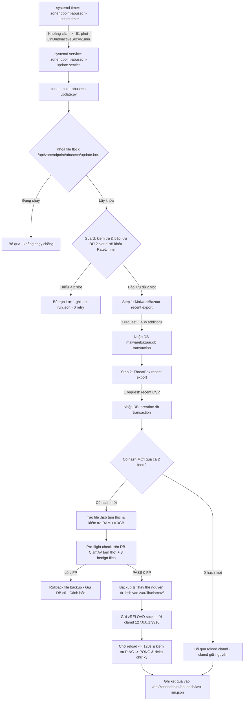

# Zonendpoint abuse.ch Hourly Update Scheduler (MalwareBazaar + ThreatFox)

**Tài liệu vận hành hệ thống cập nhật tự động hàng giờ cho feed abuse.ch**  
**Phê duyệt**: Zon (2026-11-11 "Bật mỗi giờ")  
**Môi trường áp dụng**: Lab server `udevlevel73` (`100.96.250.245`, ClamAV 1.5.4, Python 3.14.4)  
**Phạm vi**: Phòng vệ nội bộ phi thương mại trên 1–2 máy (Zon confirmed 2026-11-10)  
**Trạng thái hiện tại**: Đã cài đặt đầy đủ unit files, **MẶC ĐỊNH ĐANG TẮT** (`disabled`, `inactive`), sẵn sàng kích hoạt khi có lệnh.

---

## 1. Kiến trúc & Nguyên lý Vận hành

Hệ thống cập nhật hàng giờ được thiết kế theo mô hình **Server-side Aggregator & Single Reload**, đáp ứng nghiêm ngặt chính sách của Zon:



### Các nguyên tắc bất biến (Invariants)
1. **Thứ tự thực thi**: Luôn là **MalwareBazaar trước**, sau đó đến **ThreatFox**.
2. **Hạn mức chung (Rate Limiting)**:
   - Dùng chung ledger `/opt/zonendpoint/abusech/rate_limit.json`.
   - **Tối đa 3 request/giờ** (sliding window 3600s) và **400 request/24h**.
   - Mỗi chu kỳ cập nhật tiêu thụ tối đa 2 request (1 cho MB, 1 cho TF).
   - Nếu gặp hạn mức, lỗi mạng, HTTP 429, 403, blacklist: **Bỏ lượt ngay lập tức**, chờ lần kích hoạt giờ tiếp theo, tuyệt đối **KHÔNG retry liên tục**.
3. **Bảo mật khóa (Secret Zero-Exposure)**:
   - Auth-Key nạp từ `/etc/zonendpoint/abusech.key` (mode `0600 root:root`).
   - Tuyệt đối không truyền qua command-line arguments (`sys.argv`), không in ra console, log, journal hay `last-run.json`.
   - Toàn bộ URL tải về có nhúng key đều được mặt nạ hóa thành `<AUTH-KEY>`.
   - Chỉ server gọi abuse.ch; client hưởng kết quả gián tiếp qua ClamAV daemon (`127.0.0.1:3310`).
4. **Tối ưu clamd Reload (Single Reload)**:
   - Clamd reload **tối đa 1 lần mỗi giờ**.
   - Nếu cả 2 feed **không có hash mới**: clamd **KHÔNG reload**.
   - Nếu có hash mới: cả 2 file `.hsb` được kiểm thử đồng thời trên temporary DB, thay thế nguyên tử cùng lúc và chỉ gọi `zRELOAD` đúng 1 lần.
5. **An toàn bộ nhớ & thời gian**:
   - Kiểm tra RAM khả dụng $\ge 3.0$ GB trước khi deploy.
   - Ngưỡng timeout reload clamd $\le 120.0$ s. Nếu quá hạn sẽ hủy và rollback file `.hsb` cũ.

---

## 2. Các tệp tin cấu hình & Dữ liệu

| Đường dẫn | Quyền | Mục đích |
|---|---|---|
| `/usr/local/bin/zonendpoint-abusech-update.py` | `0755 root:root` | Script điều phối cập nhật chính |
| `/usr/local/bin/zonendpoint-malwarebazaar.py` | `0755 root:root` | Module xử lý feed MalwareBazaar |
| `/usr/local/bin/zonendpoint-threatfox.py` | `0755 root:root` | Module xử lý feed ThreatFox |
| `/usr/local/bin/abusech_rate_limit.py` | `0755 root:root` | Module quản lý hạn mức chung (RateLimiter) |
| `/etc/systemd/system/zonendpoint-abusech-update.service` | `0644 root:root` | Unit service thực thi oneshot |
| `/etc/systemd/system/zonendpoint-abusech-update.timer` | `0644 root:root` | Unit timer lên lịch hàng giờ |
| `/etc/zonendpoint/abusech.key` | `0600 root:root` | Khóa Auth-Key duy nhất |
| `/opt/zonendpoint/abusech/rate_limit.json` | `0644 root:root` | Ledger lưu lịch sử các request |
| `/opt/zonendpoint/abusech/last-run.json` | `0644 root:root` | Trạng thái chi tiết của lần chạy gần nhất |
| `/opt/zonendpoint/abusech/update.lock` | `0644 root:root` | File lock chống chạy chồng |
| `/var/backups/clamav-malwarebazaar/malwarebazaar.hsb.bak` | `0644 root:root` | Bản sao lưu chữ ký MB trước reload |
| `/var/backups/clamav-threatfox/threatfox.hsb.bak` | `0644 root:root` | Bản sao lưu chữ ký TF trước reload |

---

## 3. Cấu hình systemd

### Service (`/etc/systemd/system/zonendpoint-abusech-update.service`)
```ini
[Unit]
Description=Zonendpoint Hourly abuse.ch (MalwareBazaar + ThreatFox) Feed Update
Documentation=https://bazaar.abuse.ch/ https://threatfox.abuse.ch/
After=network-online.target clamd.service
Wants=network-online.target clamd.service

[Service]
Type=oneshot
ExecStart=/usr/local/bin/zonendpoint-abusech-update.py
TimeoutStartSec=600

# Security hardening
NoNewPrivileges=yes
PrivateTmp=yes
ProtectHome=read-only
ProtectSystem=full
ReadWritePaths=/opt/zonendpoint /var/lib/clamav /var/backups /tmp
ReadOnlyPaths=/etc/zonendpoint

User=root
Group=root
```

### Timer (`/etc/systemd/system/zonendpoint-abusech-update.timer`)
```ini
[Unit]
Description=Zonendpoint Hourly abuse.ch (MalwareBazaar + ThreatFox) Feed Update Timer
Documentation=https://bazaar.abuse.ch/ https://threatfox.abuse.ch/

[Timer]
OnBootSec=5min
OnUnitInactiveSec=61min
AccuracySec=1min
Persistent=false

[Install]
WantedBy=timers.target
```
*Ghi chú (Task V-43/V-44 fix theo Q-31 & Q-32)*:
- Sử dụng timer đơn điệu đếm từ khi kết thúc (`OnUnitInactiveSec=61min`) thay vì `OnCalendar=hourly` hay `OnUnitActiveSec=61min`. Bộ đếm 61 phút bắt đầu tính **từ thời điểm lượt trước HOÀN TẤT (deactivation)**. Kể cả khi một lượt chạy lâu (request ThreatFox bị trễ tới gần ngưỡng timeout 600s), lượt tiếp theo vẫn được kích hoạt cách thời điểm kết thúc $\ge 61$ phút. Do đó, tất cả các request của lượt trước đều đã trôi khỏi cửa sổ trượt 60 phút (3600s) $\rightarrow$ luôn còn đủ 3 slot $\rightarrow$ MB và TF đều đạt 100% tỷ lệ chạy.
- `AccuracySec=1min` giữ độ trôi kích hoạt trong biên độ an toàn 61–62 phút sau khi kết thúc.
- `Persistent=false` đảm bảo không gọi bù dồn dập sau khi reboot.
- **Guard bảo lưu 2 slot**: `zonendpoint-abusech-update.py` kiểm tra và bảo lưu nguyên tử 2 slot dưới khóa `rate_limit.json.lock` trước khi chạy. Nếu có request thủ công chen ngang khiến hạn mức còn $< 2$, hệ thống bỏ trọn lượt (cả MB và TF) để bảo đảm tính công bằng 100%.

---

## 4. Hướng dẫn Vận hành

### A. Kích hoạt Timer (Bật chạy tự động mỗi giờ)
Khi Zon phê duyệt bật lịch chạy chính thức trên Lab:
```bash
sudo systemctl daemon-reload
sudo systemctl enable --now zonendpoint-abusech-update.timer
```

> [!IMPORTANT]
> **Hành vi khi bật `enable --now` trên máy chủ đã boot > 5 phút**:
> Vì máy chủ đã khởi động quá 5 phút (`uptime > 5min`), mốc `OnBootSec=5min` đã quá hạn nên theo ngữ nghĩa của systemd, lượt cập nhật đầu tiên sẽ **CHẠY NGAY LẬP TỨC** ngay khi lệnh kích hoạt được thực thi.
> - Lượt đầu này sẽ tiêu thụ 2 request (1 MalwareBazaar, 1 ThreatFox).
> - Nếu có hash mới, lượt đầu có thể kích hoạt reload clamd (mất khoảng 25 giây).
> - Các lượt tiếp theo sẽ tự động được lên lịch cách nhau **$\ge 61$ phút tính từ lúc lượt trước KẾT THÚC** (`OnUnitInactiveSec=61min`).

Xác nhận trạng thái timer:
```bash
systemctl status zonendpoint-abusech-update.timer
systemctl list-timers zonendpoint-abusech-update.timer
```

### B. Vô hiệu hóa Timer (Tắt chạy tự động)
Nếu cần tạm dừng cập nhật tự động:
```bash
sudo systemctl disable --now zonendpoint-abusech-update.timer
```

Xác nhận:
```bash
systemctl is-active zonendpoint-abusech-update.timer  # Kết quả: inactive
systemctl is-enabled zonendpoint-abusech-update.timer # Kết quả: disabled
```

### C. Chạy thủ công tức thì (On-demand execution)
Để kích hoạt một lần cập nhật ngay lập tức thông qua systemd service:
```bash
sudo systemctl start zonendpoint-abusech-update.service
```

Xem kết quả trạng thái chạy:
```bash
systemctl status zonendpoint-abusech-update.service --no-pager
```

### D. Xem Nhật ký (Logs) và Trạng thái
1. **Xem nhật ký chi tiết qua journalctl**:
```bash
sudo journalctl -u zonendpoint-abusech-update.service --no-pager -n 50
```

2. **Xem file trạng thái lần chạy gần nhất (`last-run.json`)**:
```bash
sudo cat /opt/zonendpoint/abusech/last-run.json
```
Ví dụ cấu trúc output:
```json
{
  "timestamp": "2026-11-11T09:37:16.954850+00:00",
  "duration_seconds": 47.02,
  "requests": {
    "malwarebazaar": 1,
    "threatfox": 1,
    "total": 2
  },
  "new_hashes": {
    "malwarebazaar": 182,
    "threatfox": 258,
    "total": 440
  },
  "reloaded": true,
  "signatures_before": 8614224,
  "signatures_after": 8614555,
  "reload_duration_seconds": 24.66,
  "error": null
}
```

3. **Xem tình trạng hạn mức request (Rate Limiter)**:
```bash
sudo cat /opt/zonendpoint/abusech/rate_limit.json
```

---

## 5. Quy trình Khôi phục & Rollback

Nếu sau khi cập nhật chữ ký clamd gặp sự cố (ví dụ False Positive hoặc lỗi bộ nhớ):

### Cách 1: Khôi phục bằng bản backup tự động
Hệ thống tự động lưu bản backup của file `.hsb` trước mỗi lần reload. Khôi phục lại:
```bash
# Khôi phục MalwareBazaar
if [ -f /var/backups/clamav-malwarebazaar/malwarebazaar.hsb.bak ]; then
    sudo cp -f /var/backups/clamav-malwarebazaar/malwarebazaar.hsb.bak /var/lib/clamav/malwarebazaar.hsb
    sudo chown clamav:clamav /var/lib/clamav/malwarebazaar.hsb
    sudo chmod 0644 /var/lib/clamav/malwarebazaar.hsb
fi

# Khôi phục ThreatFox
if [ -f /var/backups/clamav-threatfox/threatfox.hsb.bak ]; then
    sudo cp -f /var/backups/clamav-threatfox/threatfox.hsb.bak /var/lib/clamav/threatfox.hsb
    sudo chown clamav:clamav /var/lib/clamav/threatfox.hsb
    sudo chmod 0644 /var/lib/clamav/threatfox.hsb
fi

# Reload clamd
echo -n -e 'zRELOAD\0' | nc -w 15 127.0.0.1 3310
echo PING | nc -w 3 127.0.0.1 3310
```

### Cách 2: Dùng script rollback độc lập
```bash
# Rollback MalwareBazaar
sudo /usr/local/bin/zonendpoint-malwarebazaar-rollback.sh

# Rollback ThreatFox
sudo /usr/local/bin/zonendpoint-threatfox-rollback.sh
```

---

## 6. Kiểm tra An toàn & Rà soát Bí mật (Secret Audit)

Lệnh kiểm tra định kỳ xem có bất kỳ rò rỉ Auth-Key nào vào log hay không:
```bash
sudo sh -c 'journalctl -u zonendpoint-abusech-update.service --no-pager | grep -Ff /etc/zonendpoint/abusech.key || echo JOURNAL_CLEAN'
sudo sh -c 'grep -rlFf /etc/zonendpoint/abusech.key /var/log /opt/zonendpoint/abusech/last-run.json || echo NO_KEY_LEAKED'
```
Kết quả mong đợi: `JOURNAL_CLEAN` và `NO_KEY_LEAKED`.
